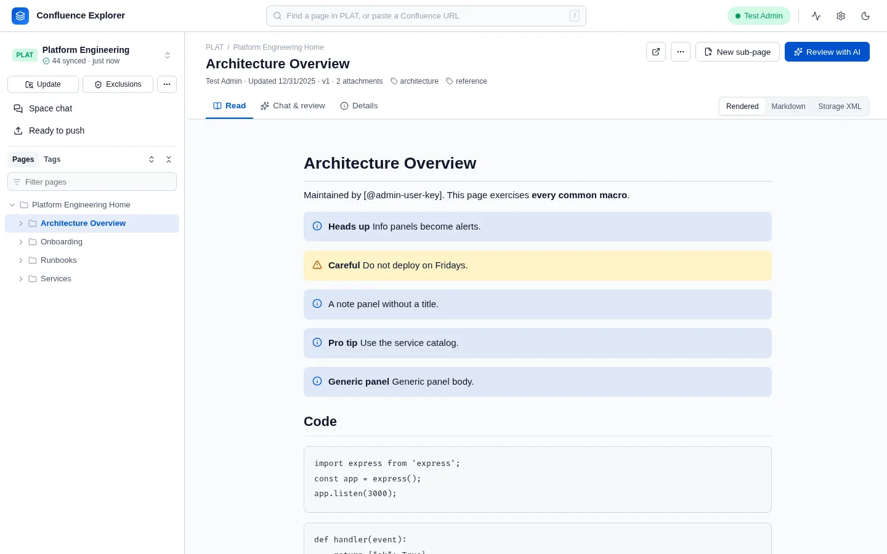

# @simplysf/simply-confluence-explorer

A local web app for working with Confluence Server and Data Center, packaged as a Node.js command.
You run it on your own computer and use it in your browser: browse a space, keep a copy of it on
disk as Markdown, ask an AI about a page or a whole space, and improve pages and push them back. Part
of the [`simply-confluence-explorer`](https://github.com/SimplySF/simply-confluence-explorer)
monorepo.



> **Status:** every feature below is built, in the server and in the browser. Each release is
> published to npm once a second person has approved it. The AI features have so far run
> only against a stand-in for each provider, not with real provider keys.

The [guides](https://simplysf.github.io/simply-confluence-explorer/) explain each feature in full, with screenshots. This README is the reference:
options, environment variables, where data is kept, the HTTP routes and the embedding API.

## Requirements

- Node.js 22 or later.
- A Confluence Server or Data Center instance, and a personal access token for your account.
  Atlassian Cloud is not supported.
- Optionally, an API key for Claude, ChatGPT or Gemini, or the Gemini CLI, for the AI features.

## Usage

```sh
npx @simplysf/simply-confluence-explorer
# Confluence Explorer is running at http://127.0.0.1:4280/
```

Open the address it prints. The app runs until you press Ctrl+C.

| Option              | Environment                | Default                  | Description                                    |
| ------------------- | -------------------------- | ------------------------ | ---------------------------------------------- |
| `-p`, `--port <n>`  | `PORT`                     | `4280`                   | Port to listen on; `0` picks a free port       |
| `--host <host>`     | `HOST`                     | `127.0.0.1`              | Interface to bind; set explicitly to expose it |
| `--data-dir <path>` | `CONFLUENCE_EXPLORER_DATA` | `~/.confluence-explorer` | Where the app keeps everything it writes       |
| `-h`, `--help`      |                            |                          | Show usage                                     |

A flag wins over its environment variable. The server listens on localhost only unless you pass
`--host`. It holds your Confluence token and has no login of its own, so think twice before exposing
it on a network. When it is reached by another name, list that name in `ALLOWED_HOSTS`; every other
host name, and every request another website sends from your browser, is refused
(`test/security.test.ts`).

### Checking your setup

```sh
npx @simplysf/simply-confluence-explorer doctor
```

The doctor checks the Node version, the Confluence connection, certificate checking, the data
directory, each space's exclusion and leak guard rules, and the AI setup. It prints what to do about
each problem it finds, and exits with a non-zero status only when something is broken. `--json`
prints the report as JSON (`test/doctor.test.ts`). [Troubleshooting](https://simplysf.github.io/simply-confluence-explorer/guides/troubleshooting/)
explains every check.

### Connecting to Confluence

Save the URL and a personal access token in the app's Settings. The token stays on the server and is
never sent back to the browser (`test/connection.test.ts`). To set the connection outside the app
instead, use these variables, either in the environment or in a `.env` file in the data directory:

```sh
CONFLUENCE_URL=https://confluence.example.com
CONFLUENCE_PERSONAL_TOKEN=<your personal access token>
```

When `CONFLUENCE_URL` is set, it is the connection, and Settings shows it without letting it be
changed. A variable in the real environment wins over the same one in the `.env` file.

Certificates are always verified. If your Confluence uses a certificate from your company's own
certificate authority, ask your IT team for that authority's certificate file and start the app with
`NODE_EXTRA_CA_CERTS` pointing at it:

```sh
NODE_EXTRA_CA_CERTS=/path/to/company-ca.pem npx @simplysf/simply-confluence-explorer
```

[Connecting to Confluence](https://simplysf.github.io/simply-confluence-explorer/guides/connecting/) covers creating a token and the connection in
detail.

### Choosing an AI

Choose the provider, model and key in the app's Settings. Keys are kept on the server and never sent
back to the browser (`test/ai.test.ts`). The environment can supply them instead:
`ANTHROPIC_API_KEY`, `OPENAI_API_KEY` or `GEMINI_API_KEY`, with `AI_PROVIDER` naming which one to use
(`anthropic`, `openai`, `gemini`, or `gemini-cli` for the Gemini command-line tool, found on `PATH`
or at `GEMINI_CLI_PATH`). A value saved in Settings wins over the environment.

Before anything is sent, the page is checked against the space's `.confluenceignore`, and the
request passes the outbound guard: a secret stops it, and personal data is replaced with
placeholders that are put back in the answer here (`test/aiRoutes.test.ts`, `test/guard.test.ts`).
Each request is recorded in `data/ai-audit.jsonl` in the data directory, without its content.
[What leaves your computer](https://simplysf.github.io/simply-confluence-explorer/guides/data-safety/) explains the exclusion rules and the leak
guard, including how to write your own rules.

### Writing to Confluence

A page changes only when a push is sent for it. The push names the version its proposal was made
from, and is refused if the page has changed since, so a colleague's edit is never replaced unseen
(`test/pagePush.test.ts`, and against a real Confluence, `test/e2e/push.e2e.ts`). The frontmatter
block the app adds to a page's Markdown is removed before the page is written. A section review writes
only the pages a person accepted, through the same path (`test/branchRuns.test.ts`,
`test/e2e/branches.e2e.ts`).

A page that holds an image, a macro such as a status label or a panel, a link to another page, a
mention or a task list is never written from Markdown. Markdown has no form for those parts, so
writing the page back would replace each of them with placeholder text. The dry run and the push
refuse such a page, name what it would lose, and write nothing; that change has to be made in
Confluence itself (`test/pagePush.test.ts`, `test/converter.test.ts`, and against a real Confluence,
`test/e2e/push.e2e.ts`).

Before a new page is drafted, the app searches the space for pages that already say what it will
say, and nothing is written or created until the author has answered that check: improve an existing
page instead, link to the pages found, or go ahead. Excluded pages are never offered as a match. A
title already used in the space is refused with the reason (`test/drafts.test.ts`,
`test/e2e/drafts.e2e.ts`).

## Guides

| Guide                                                                                                      | What it covers                                                                        |
| ---------------------------------------------------------------------------------------------------------- | ------------------------------------------------------------------------------------- |
| [Get started](https://simplysf.github.io/simply-confluence-explorer/getting-started/)                      | Requirements, starting the app, connecting, and your first few minutes                |
| [Connecting to Confluence](https://simplysf.github.io/simply-confluence-explorer/guides/connecting/)       | Personal access tokens, environment variables, company certificates                   |
| [Keeping a copy on disk](https://simplysf.github.io/simply-confluence-explorer/guides/syncing-a-space/)    | Syncing a space, the Markdown it produces, the table of contents, the ZIP             |
| [Asking an AI](https://simplysf.github.io/simply-confluence-explorer/guides/asking-ai/)                    | Providers, chats about a page, a directory, tags or the whole space, files, summaries |
| [What leaves your computer](https://simplysf.github.io/simply-confluence-explorer/guides/data-safety/)     | Excluded pages, the leak guard and its rules, the audit log, network access           |
| [Changing pages from a chat](https://simplysf.github.io/simply-confluence-explorer/guides/changing-pages/) | Suggestions from a chat, the queue of edits, pushing, and pages that cannot be pushed |
| [Writing a new page](https://simplysf.github.io/simply-confluence-explorer/guides/new-pages/)              | The check for existing pages, writing with an AI, creating the page                   |
| [Troubleshooting](https://simplysf.github.io/simply-confluence-explorer/guides/troubleshooting/)           | The doctor's checks, and the messages you are most likely to see                      |
| [Trying it locally](https://simplysf.github.io/simply-confluence-explorer/guides/trying-it-locally/)       | Running the app from its source against a local test Confluence, and its tests        |

The guides are on the [documentation site](https://simplysf.github.io/simply-confluence-explorer/), with
search. They are written in this package's [`docs/`](docs) folder.

## Where data is kept

Everything the app writes is in its data directory, `~/.confluence-explorer` unless `--data-dir` or
`CONFLUENCE_EXPLORER_DATA` names another. Files holding a token, a key or a conversation are created
readable only by your user account where the operating system allows it (`test/util.test.ts`).

| Path                      | What it holds                                                                                                                |
| ------------------------- | ---------------------------------------------------------------------------------------------------------------------------- |
| `.env`                    | Optional Confluence connection variables, read at start and never written                                                    |
| `config/connection.json`  | The Confluence URL and personal access token                                                                                 |
| `config/ai-settings.json` | The AI provider, models, endpoints and keys                                                                                  |
| `spaces/<KEY>/`           | A synced space: its Markdown pages and attachments, summaries, table of contents, `.confluenceignore` and `.confluenceguard` |
| `data/sessions/`          | AI conversations, drafts of new pages, and the text of files added to them                                                   |
| `data/branch-runs/`       | Section reviews and their queues                                                                                             |
| `data/ai-audit.jsonl`     | One line per AI request, without its content                                                                                 |

## Keyboard shortcuts

| Keys                    | What they do                                                          |
| ----------------------- | --------------------------------------------------------------------- |
| Ctrl+, (Cmd+, on a Mac) | Open or close Settings                                                |
| `/`                     | Jump to the page filter                                               |
| ↑ ↓, Home, End          | Move through the page tree                                            |
| → and ←                 | Expand or collapse a page in the tree, or move to its child or parent |
| Enter or Space          | Open the page selected in the tree                                    |
| Escape                  | Close the topmost dialog or menu                                      |

## HTTP routes

| Route                                                 | Description                                                                                                                                                                                   |
| ----------------------------------------------------- | --------------------------------------------------------------------------------------------------------------------------------------------------------------------------------------------- |
| `GET /api/health`                                     | `{ "status": "ok", "version": "<package version>" }`                                                                                                                                          |
| `GET /api/connection`                                 | The Confluence URL, whether a token is saved, and where the connection comes from                                                                                                             |
| `PUT /api/connection`                                 | Saves `{ baseUrl, token }`; the token is never returned                                                                                                                                       |
| `GET /api/doctor`                                     | The doctor's report, as `confluence-explorer doctor --json` prints it                                                                                                                         |
| `POST /api/auth/verify`                               | Tests the saved connection, or one typed into Settings, without saving it                                                                                                                     |
| `GET /api/spaces`                                     | Every global space; `?query=` filters by key or name                                                                                                                                          |
| `GET /api/spaces/detail/:spaceKey`                    | One space                                                                                                                                                                                     |
| `POST /api/spaces/resolve-url`                        | Finds the page id and space key in a pasted address or page id                                                                                                                                |
| `GET /api/spaces/:spaceKey/pages`                     | The space's page tree, or the tree under `?rootPageId=`, without excluded pages                                                                                                               |
| `GET /api/pages/:pageId`                              | One page and its Markdown; an excluded page is a `404`                                                                                                                                        |
| `GET`/`POST /api/space-cache/:spaceKey/ignore`        | Reads or saves the space's `.confluenceignore` rules; with `purge: true`, also deletes the synced copies they now exclude                                                                     |
| `GET /api/space-cache/cached`                         | The spaces synced to this machine                                                                                                                                                             |
| `POST /api/space-cache/sync`                          | Starts syncing `{ spaceKey, rootPageId? }` to disk; poll `GET /api/space-cache/sync/status/:jobId`                                                                                            |
| `GET /api/space-cache/:spaceKey/toc`                  | The synced space's table of contents                                                                                                                                                          |
| `GET /api/space-cache/:spaceKey/tags`                 | Every tag in the synced space, from labels and AI summaries, with its pages; excluded pages are left out                                                                                      |
| `GET /api/space-cache/:spaceKey/zip`                  | The synced space as a ZIP of Markdown and attachments, without excluded pages                                                                                                                 |
| `POST /api/space-cache/:spaceKey/pages/:pageId/purge` | Removes a synced page, optionally with what is below it and a rule to keep it away                                                                                                            |
| `POST /api/space-cache/:spaceKey/cache/purge`         | Removes synced copies that are excluded, or whose Markdown was deleted from the folder                                                                                                        |
| `GET`/`PUT /api/ai/settings`                          | The AI provider, model and endpoint; keys can be saved but are never returned                                                                                                                 |
| `GET /api/ai/models/:provider`                        | The models the saved key can use                                                                                                                                                              |
| `GET /api/ai/status`, `POST /api/ai/test`             | Whether an AI is set up; a test call that sends no page                                                                                                                                       |
| `POST /api/ai/analyze`                                | One question about a page, optionally with its sub-pages; the server sends its own copy of the page it checked, never text the request supplies                                               |
| `POST /api/space-cache/:spaceKey/ai/ask`              | One question about a synced space, answered from the sections it retrieves                                                                                                                    |
| `/api/ai/sessions/...`                                | Chats: create one on a page, a directory, chosen directories, pages and tags, or the whole space; list, read, rename or change what it reads (`PATCH`), delete, upload a file, send a message |
| `POST /api/ai/sessions/:sessionId/suggest`            | Asks for suggestions, `{ kind: "review" }` or `{ kind: "changes" }`, stored with the answer; too many pages for one request start a batched review, `{ batch }`                               |
| `POST /api/ai/sessions/:sessionId/turns/:turn/queue`  | Stages an edit of each page the chosen suggestions `{ findings: [indexes] }` of that answer name                                                                                              |
| `GET /api/ai/batches/:jobId`, `POST .../cancel`       | A batched review's progress, and stopping it; `GET /api/ai/sessions/:sessionId/batch` finds the one running in a chat                                                                         |
| `POST /api/space-cache/:spaceKey/metadata/generate`   | Builds the AI index (summaries, topics, and embeddings when the provider makes them), `{ rootPageId }` or `{ dirs, pageIds, tags }`; poll `GET /api/space-cache/metadata/status/:jobId`       |
| `POST /api/space-cache/:spaceKey/metadata/coverage`   | How many of some pages are in the AI index, and whether they fit one request                                                                                                                  |
| `POST /api/pages/:pageId/dry-run`                     | Converts a change as a push would, and reports anything Confluence would refuse, without writing                                                                                              |
| `POST /api/pages/:pageId/push`                        | Writes `{ markdown, baseVersion }`; refused with a `409` if the page has changed since `baseVersion`                                                                                          |
| `GET /api/branches/runs/:runId`                       | A queue of staged edits, with each page's edit and decision                                                                                                                                   |
| `PATCH /api/branches/runs/:runId/items/:pageId`       | Accepts (optionally with edits), rejects or resets one page's staged edit                                                                                                                     |
| `POST /api/branches/runs/:runId/check`, `.../push`    | Dry-runs, or writes, every accepted page, one at a time, each against its own base version                                                                                                    |
| `POST /api/drafts`                                    | Starts a draft of `{ spaceKey, parentId, title, notes }` and checks the space for pages that already cover it                                                                                 |
| `POST /api/drafts/:sessionId/recheck`                 | Runs the check for similar pages again                                                                                                                                                        |
| `POST /api/drafts/:sessionId/decision`                | Answers the check with `update-existing`, `link` (with pages it found) or `continue`                                                                                                          |
| `POST /api/drafts/:sessionId/messages`                | Asks the AI to help write the draft; a revision it proposes is kept apart until saved                                                                                                         |
| `PUT /api/drafts/:sessionId`                          | Saves the draft's Markdown                                                                                                                                                                    |
| `POST /api/drafts/:sessionId/check`, `.../create`     | Dry-runs, or creates, the page under its parent, once                                                                                                                                         |
| `GET`/`POST /api/space-cache/:spaceKey/guard`         | Reads or saves the space's `.confluenceguard` rules; a rule that does not parse is refused                                                                                                    |
| `GET`/`PUT /api/gitlab`, `POST /api/gitlab/test`      | Reads, saves or tests the GitLab connection; the token is never returned                                                                                                                      |
| `POST /api/drafts/:sessionId/repositories`            | Adds what a GitLab repository says about itself to a draft, as a file                                                                                                                         |
| `/api/*`                                              | Anything else under `/api` is a JSON `404`, never the app shell                                                                                                                               |
| everything else                                       | The built frontend, falling back to `index.html` for client-side routes                                                                                                                       |

A page listed in a space's `.confluenceignore` is left out of every tree, together with everything
below it, and reading it answers `404`, so it never reaches the browser (`test/browse.test.ts`, and
against a real Confluence, `test/e2e/browse.e2e.ts`).

Request bodies must be JSON, because a plain web form cannot send JSON and so a form on another site
cannot post to the server. Errors are JSON with an `error` message and never include a stack trace.

## API

The package can also be embedded. Everything below is exported from the package root.

| Export                   | Description                                                                                                  |
| ------------------------ | ------------------------------------------------------------------------------------------------------------ |
| `main(options?)`         | Parses `argv`, starts the server (or runs `doctor`), and logs the URL. Takes `argv`, `env`, and a `log` sink |
| `createServer(options?)` | Creates an unstarted `http.Server`. Options: `webRoot`, `version`, `dataDir`, `env`, `log`                   |
| `DEFAULT_HOST`           | `'127.0.0.1'`                                                                                                |
| `DEFAULT_PORT`           | `4280`                                                                                                       |
| `DEFAULT_WEB_ROOT`       | Absolute path to this package's built frontend (`dist/web`)                                                  |

Types: `MainOptions`, `ServerOptions`, `HealthResponse`, and the API's JSON shapes: `ConnectionView`,
`ConnectionUpdate`, `DoctorReport`, `DoctorResult`, `ErrorResponse`.

## Issues

Please report bugs or request features by
[opening an issue](https://github.com/SimplySF/simply-confluence-explorer/issues).

## Contributing

See [CONTRIBUTING.md](https://github.com/SimplySF/simply-confluence-explorer/blob/main/CONTRIBUTING.md)
in the repository, and this package's own [CONTRIBUTING.md](CONTRIBUTING.md).

## License

Licensed under the [Apache-2.0](https://github.com/SimplySF/simply-confluence-explorer/blob/main/LICENSE.txt)
license.
