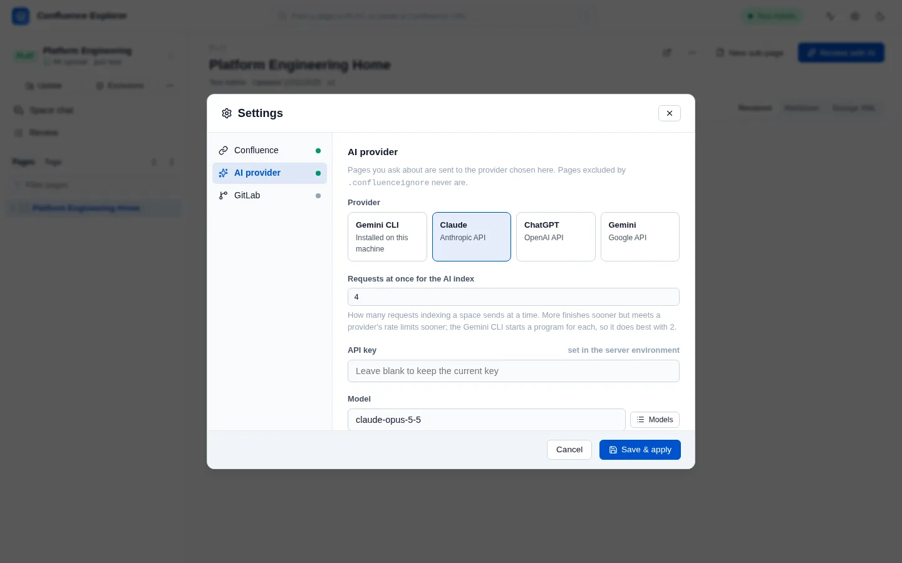
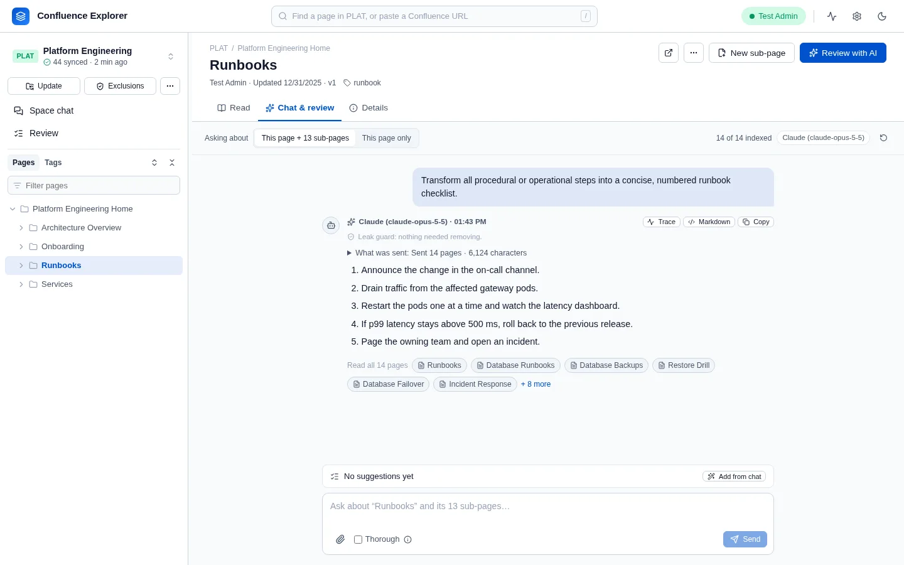
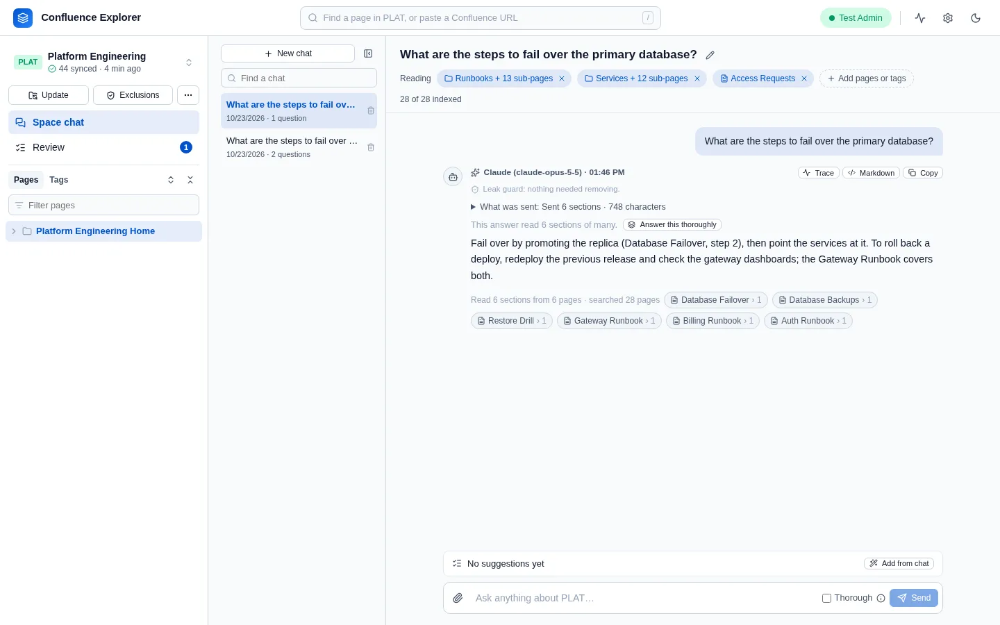
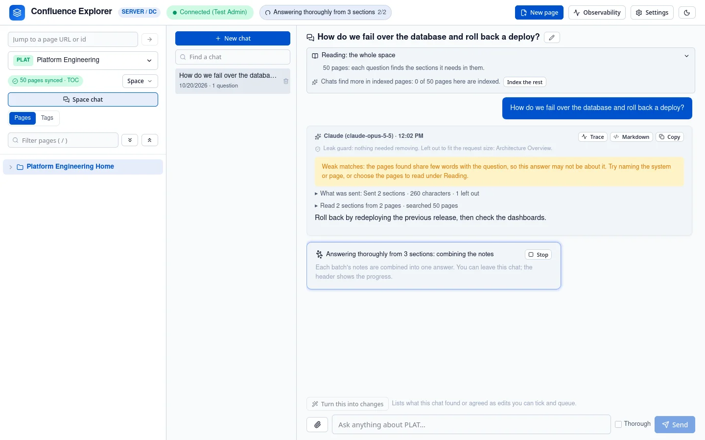
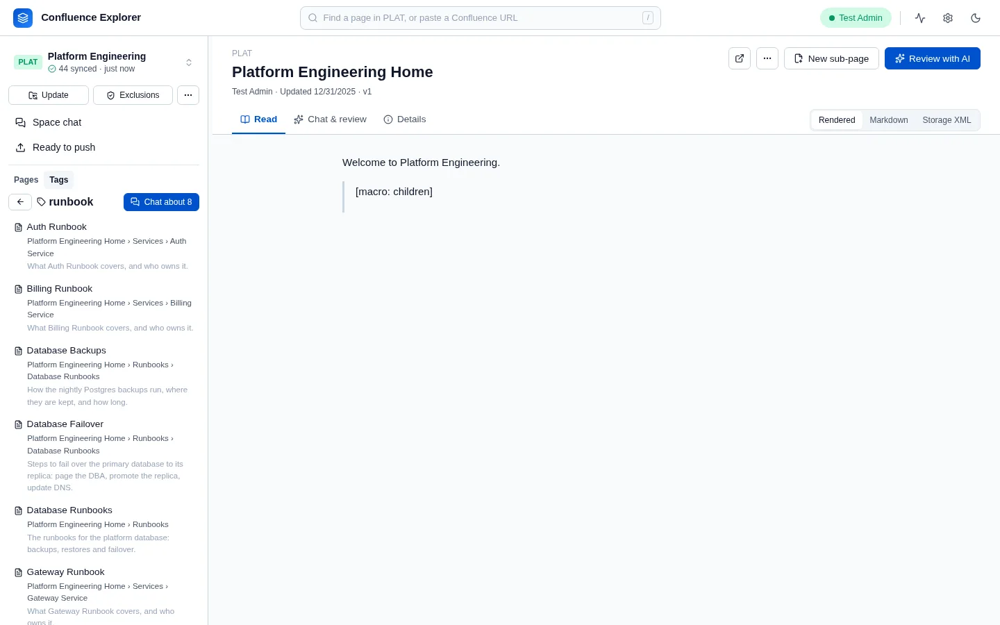

Confluence Explorer can send a page, or several, to an AI along with your question, and show the
answer next to the page. Before anything is sent, the app removes excluded pages and passes the rest
through the leak guard; [What leaves your computer](/guides/data-safety/) explains both.

The AI features have so far been tested only against a stand-in for each provider's service, not
with real provider keys. Expect rough edges with a real provider, and report them.

## Choose a provider

Open **Settings** and expand **AI provider**.

| Provider               | What you need                                                                                          |
| ---------------------- | ------------------------------------------------------------------------------------------------------ |
| Gemini CLI             | The [Gemini CLI](https://github.com/google-gemini/gemini-cli) installed and signed in on this computer |
| Claude (Anthropic API) | An Anthropic API key                                                                                   |
| ChatGPT (OpenAI API)   | An OpenAI API key, and a model you choose                                                              |
| Gemini (Google API)    | A Google AI API key                                                                                    |

- **API key**: paste it and click **Save & apply**. The key is stored on your computer and never
  sent back to the browser; the field only says whether a key is set, and where it came from.
- **Model**: Claude and Gemini start with a sensible default. For ChatGPT you must choose one. After
  saving a key, **Models** lists the models that key can use.
- **Endpoint (optional)**: leave it empty to use the provider's public service, or enter your
  company's AI gateway address if requests must go through one.
- **Test** sends the fixed sentence "This is a connection test." to the provider, with no page, and
  shows the reply.

The AI settings are saved separately from the Confluence connection, with their own **Save AI
settings** button, and take effect at once.

You can also set a key with the environment variables `ANTHROPIC_API_KEY`, `OPENAI_API_KEY` or
`GEMINI_API_KEY`, and the provider with `AI_PROVIDER`. A key saved in Settings wins over the
environment.

## Chat about a page or a directory

Open a page and click **Review with AI**, or choose its **Chat & review** tab.

1. Choose what the chat reads:
   - **With sub-pages**: the page and every page under it, if the space is synced. This is chosen
     whenever the page has sub-pages, so a directory is read as a whole.
   - **This page**: the page you are looking at, on its own.
2. Before the first question, the chat offers ways to begin, each with a line saying what it gives:
   **Review for problems** (or **Suggest improvements** for one page), **Summary**, **Action items &
   decisions**, **Technical review**, **Runbook checklist** and **Explain simply**. Click one, or
   type your own question and click **Send**. Space chat offers its own: **Review for problems** and
   **Summarise these pages** on chosen pages, and questions that find your way around a whole space.

The answer appears under your question, with the provider's name and the time, a line saying what
the leak guard did, and **Read N pages**, which lists the pages it read. **What was sent** counts the
pages, sections, files and earlier messages that reached the AI, and names anything left out and
why: over the size limit, holding a secret, or excluded, which is counted but never named. The app
checks every request against this list before sending it, and refuses one that is missing anything.
An answer the AI stopped writing early says it was cut short. **Trace** shows how long each step
took. **Markdown** shows the answer's source text, and **Copy** copies it. To change pages from a chat, see
[Changing pages from a chat](/guides/changing-pages/).

While the AI is answering, the note above the box says which step it is on, such as searching the
pages, choosing sections or writing the answer. **Send** becomes **Stop**. Stopping puts your question back in the box so
you can correct it and send it again; nothing of the stopped question is kept in the conversation.
The provider may already have received it, so the app's AI log records it as stopped.

The app sends its own copy of each page, the one it checked against the exclusion rules, never text
from the browser. A page excluded from AI shows a notice instead of the question box.

### Conversations

A conversation keeps going until you click **New conversation**: each question is sent with the
earlier ones, so you can ask follow-ups. Conversations are saved on your computer, and when you come
back to a page the latest conversation for it reopens. Earlier turns are sent up to a limit, newest
first, so a very long conversation gradually forgets its start; What was sent says when it did. Every page is read and checked again
for every question, so a change to the exclusion rules applies to the next question.

### Add a file

The paperclip next to the question box adds a file to the conversation, for example a design
document or a log to compare with the page: PDF files with text in them, HTML, Markdown and plain
text, and CSV, TSV, JSON, YAML, XML and log files, up to 10 MB each. The leak guard checks files like
everything else, but exclusion rules do not apply to them, because they are not Confluence pages.

## Chat about the whole space, or about pages you choose: Space chat

**Space chat**, at the top of the sidebar, is for the space as a whole. It answers from the synced
copy, so sync the space first. Its conversations are listed on the left, newest first, and kept on
your computer. **New chat** starts another; the pencil renames one, and the bin deletes it after you
confirm.

**Reading** above the conversation shows what the chat reads, as a row of chips. With none, it reads
the **Whole space**: every page that the exclusion rules allow. **Add pages or tags** opens a search:
under **Pages**, **Page** adds a page alone and **+ N sub-pages** adds it with every page under it, so
you can choose two directories and a page from another part of the space; under **Tags**, a tag adds
every page that carries it. Each chip is removed with its ×, a directory with its sub-pages. A
directory or tag is read as it is when you ask, so a page added under it later is read too. The count
at the end of the row says how many of the pages are indexed; hover over it to see how each question
reads them.

There is no limit on how many pages a chat reads from:

- **When they fit in one request**, every question reads all of them, and the count's hint says so.
- **When there are more**, each question finds the sections it needs. Pages are split at their
  headings, and the app ranks the sections by the words of your question and the one before it,
  and, with a provider that offers embeddings, by meaning as well. The AI then picks the sections
  worth reading from their headings and summaries alone, and only those are sent, with the ones the
  last answers read. **Read N sections from M pages** on each answer lists them, with why each was
  chosen. This is the way in when you do not know the space, such as an unfamiliar system during an
  incident. When even the best sections share few words with the question, the answer warns that
  it may rest on weak matches.

For a broad question, tick **Thorough** beside **Send** (its ⓘ says what it does), or click **Answer this thoroughly** under an
answer. The question then reads up to 150 sections over as many requests as they need: each batch
is asked for notes with the page and section they came from, and one last request combines the
notes into the answer. It runs in the background with **Stop**, and the header shows the batch it is
on. A batch whose reply comes back empty twice has its pages named in the answer as not read.

**Chat about** on a tag in the sidebar's **Tags** view opens a chat on that tag's pages. A page's tags
are its Confluence labels together with its topics from the AI index. Excluded pages are never
listed, found or read, and a page holding a secret is left out and named.

## Attachments

A page's attachments are read with it, in these formats: Word, Excel, PowerPoint, OpenDocument,
Visio, PDF, HTML, text, CSV, JSON, YAML, XML, logs, Markdown, email, calendar files, notebooks, code
and configuration files, and the text files inside a zip. Gliffy, draw.io, SVG, BPMN, Mermaid and
PlantUML diagrams give their labels. Up to 50,000 characters of each are read. They are checked by
the leak guard like the page, found by search, and used by the AI index and by edits.

When a chat's pages have attachments, the chat lists them before your first question: how many,
what each will be read as, the images, and each file that cannot be read, with why, such as an older
`.doc` file. It asks whether to include them: **Include all** or **Pages only**, or untick any
file to leave it out. Until you choose, they are read. When pages added later bring new files, it
asks again about those. Every answer says the same for what it read, and What was sent names each
file that was not read, including those you left out.

Images are sent only if you choose for the space, because the leak guard cannot check them. Until
you choose, the chat says how many the AI did not see, with **Send images for PLAT** and **Not for
PLAT**. Change it later under **Exclusions** → **Images on pages**.

## The AI index: summaries, topics and embeddings

Chats find more in pages that are in the **AI index**. Indexing a page asks the AI what the page is
for, its topics, the questions it answers and who it is for, and for a line on each section, and the
search reads all of it. Topics are chosen from the ones the space already uses where one fits, so
pages about one subject share a tag wherever they sit. A chat says how many of its pages are indexed
and offers **Index the rest**, which runs in the background and shows in the header.

Small pages are indexed several to a request, up to about 60,000 characters, and a few requests run
at once: 2 for the Gemini CLI and 4 for an API provider, set by **Requests at once** in Settings.
The **⋯** menu beside **Exclusions** says how many requests a run will take before it starts. A failed request is tried
again; a page still left out is listed with its reason under **See why**, and the next run retries it.

Indexing can also make an embedding of each section, which lets a question find a section by meaning
when it shares none of its words. **Search by meaning** in Settings chooses who makes them: ChatGPT
or Gemini (Google API) when it is the provider, or a Gemini or OpenAI key of its own, so the Gemini
CLI can answer while a Gemini key makes embeddings. Claude and the Gemini CLI make none themselves.
[What leaves your computer](/guides/data-safety/) says what this sends.

The **Details** tab of a page has **Index this page** for that page alone, and shows its summary,
topics and the questions it answers. **Build the AI index**, in the sidebar's **⋯** menu, indexes every page that is not
indexed yet. A page that changes in Confluence leaves the index at the next sync, and **Update the
AI index** redoes only those pages.

## How this is checked

`test/ai.test.ts` checks how each provider is called, that a key is stored owner-only and never shown,
and that a missing key or model is reported before anything is sent. `test/sessions.test.ts` checks
conversations, the history limit, file uploads, chosen directories, pages and tags, reading in full
or by section, and finding a section by meaning. `test/sections.test.ts`, `test/searchIndex.test.ts`,
`test/metadata.test.ts`, `test/indexPacks.test.ts` and `test/embeddings.test.ts` check how pages are
split, searched, summarised, packed and embedded, and `test/retrievalEval.test.ts` measures whether
fixed questions find the right pages. `test/contextDelivery.test.ts` checks What was sent and that
every item it lists reached the AI, and `test/thoroughAnswer.test.ts` checks thorough answers. `test/aiRoutes.test.ts` checks that excluded pages are refused and that summaries reach
the table of contents. `test/e2e/ai.e2e.ts` asks questions against a real Confluence Data Center,
with a stand-in for the AI provider.
