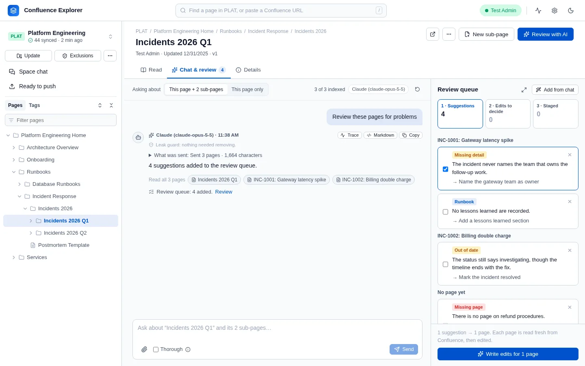
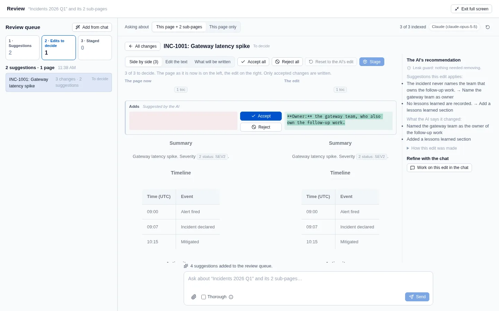

Every change Confluence Explorer makes to a page starts in a chat (see
[Asking an AI](/guides/asking-ai/)): one page, a directory, any mix of directories, pages and tags,
or the whole space. Each chat has four tabs: **Chat**, **Review**, **Changes** and **Push**. The
question box stays under every tab, so you can ask the chat to rework something while you look at
it. Nothing changes in Confluence until you confirm a push.

## Get suggestions

- **Start a chat with a review.** A new chat on a directory or on chosen pages offers **Review for
  problems**: pages that contradict or repeat each other, content that is out of date, and pages that
  are missing or in the wrong place. A new chat on one page offers **Suggest improvements**.
- **Turn a conversation into changes.** Once a chat has begun, **Turn this into changes** lists the
  changes the conversation found or agreed.

The suggestions go to the chat's **Review** tab, and the answer says how many, with a link. When a
chat's pages are too many for one request, the review reads them in batches, related pages together,
and the header shows its progress; **Stop** ends it with nothing kept.

## Rework them with the chat

Ask the chat in your own words, for example "make the first one more specific" or "drop the one
about the pager". It rewords, adds or removes suggestions, and the answer says what it changed. A
reworded suggestion keeps its earlier wordings under **Reworded**, and **Use this** puts one back.
**Dismiss** hides a suggestion and **Show dismissed** brings it back.

A suggestion to move, split or merge a page is done in Confluence, so it cannot be ticked. For a page
that should exist and does not, **Write a new page** opens [Writing a new page](/guides/new-pages/).

## Recommend changes

Tick the suggestions you want and click **Recommend changes**. Each page they name gets one edit
that carries out only those suggestions. Before the edit is written, the page is read from
Confluence. If someone changed it since the suggestion was made, the copy on your computer is
updated, and the AI first checks each suggestion against the page as it is now: one that is already
done, or no longer makes sense, is not applied and goes back to Review with the reason.

## Decide each change, side by side

The **Changes** tab lists the edits. Open one to see the page as it is now on the left and the edit
on the right. Each change sits between them with **Accept** and **Reject**, and **Undo** to change
your mind; **Accept all** and **Reject all** decide the page at once. Beside it is the AI's
recommendation: the suggestions applied, what it says it changed, and anything it did not apply.

**Work on this edit in the chat** makes your next question about that edit, shown as "Working on"
above the question box. Ask for a change, such as "shorter", and the chat proposes a revised edit;
**Accept into the edit** adds its changes for you to decide, or **Dismiss** it. **Edit the text**
lets you change the page yourself, **Reset to the AI's edit** brings back the first edit, and **What
will be written** shows the page with only the accepted changes.

Parts of a page that Markdown cannot hold, such as a table of contents, a status, a panel, an image
or a page link, appear as markers like ⟦1 toc⟧ and are written back exactly as they were. A change
that removes one says so, and the part is removed only if you accept that change. A page's own
details, such as its id, version and author, are never written into it.

## Stage and push

Once every change of a page is decided, with at least one accepted, **Stage** moves it to the
**Push** tab. Changing the edit after that unstages it, so what you push is what you looked at.
**Ready to push** in the sidebar lists the staged pages of every chat in the space.

Tick the pages to push and click **Check and push**. Each page is checked without writing anything,
then the confirmation lists what will be written and any page with a problem, with why.

Each push names the version its edit was made from. A page someone changed since is refused and
nothing is written over their change; **Make this edit again from the current page** starts again
from the page as it is now.

## What is left out

- **Excluded pages** are never read, suggested, edited or listed, and never named.
- **Pages holding a secret** are left out and listed under "Left out".

Chats, their queues and their edits are saved on your computer, so they survive restarting the app.

## How this is checked

`test/chatQueue.test.ts` checks that the chat rewords, adds and removes suggestions and an earlier
wording comes back, that an edit is made from the newer page and a suggestion already done is not
applied, that the chat's revision is accepted or dismissed and its page is checked on every turn, and
that only staged pages are pushed, never an excluded one. `test/branchRuns.test.ts` checks that each
edit carries only its own suggestions, that only accepted changes are written with a table of
contents kept, that a page changed by someone else is refused, and that a page's own details are
never written. `test/editForm.test.ts` checks that every test page is written back exactly when
nothing changes. `test/e2e/branches.e2e.ts` makes, stages and pushes an edit from a page a colleague
changed, and `test/e2e/push.e2e.ts` changes a page with a panel, against a real Confluence Data Center.
