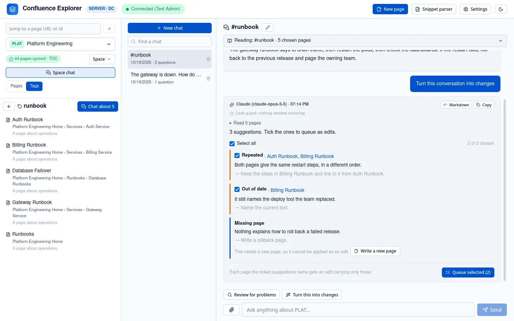
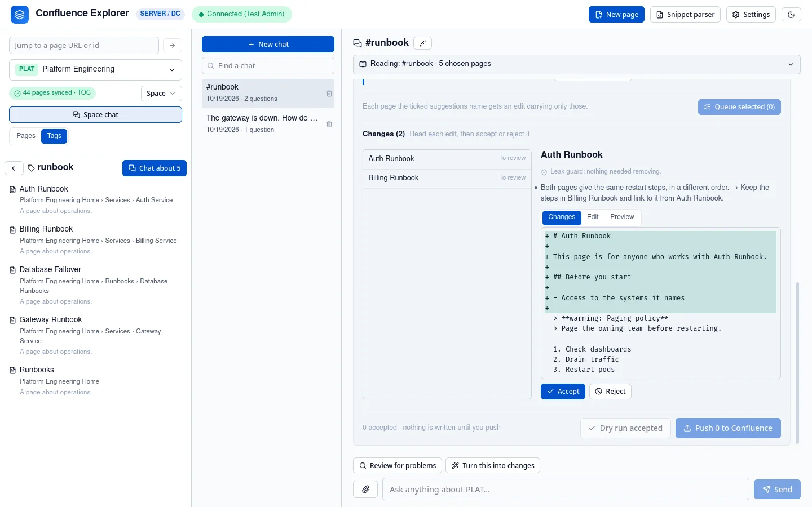

Every change Confluence Explorer makes to a page starts in a chat (see
[Asking an AI](/guides/asking-ai/)): one page, a directory, any mix of directories, pages and tags,
or the whole space.
You ask for suggestions, tick the ones you agree with, decide on each change the edits make, and
push only the changes you accept. Nothing changes in Confluence until you confirm a push.

## Get suggestions

There are two ways to get them:

- **Start a chat with a review.** A new chat on a directory or on chosen pages offers **Review for
  problems**: the AI reads the pages together and lists what is wrong across them, such as pages
  that contradict or repeat each other, content that is out of date, and pages that are missing or
  in the wrong place. A new chat on one page offers **Suggest improvements**: clarity, missing
  detail, structure and the like. To review again later, start a new chat.
- **Turn a conversation into changes.** Once a chat has begun, **Turn this into changes** under it
  lists the changes the conversation found or agreed. Talk it through first, then turn it into
  changes.

When a chat's pages are too many for one request, **Review for problems** and **Turn this into
changes** read them in batches instead. Pages that share a topic are read in the same batch, so
repetition between them is found wherever they sit, and the suggestions from every batch arrive as
one answer. The chat and the header show which batch is being read, **Stop** ends it with nothing
kept, and you can work elsewhere in the app meanwhile; the answer is in the chat when you come back.

Each suggestion names the pages it is about; click a name to open the page. Two kinds cannot be
carried out by editing a page, so they cannot be ticked: a page that should be moved, split or merged,
which you do in Confluence, and a page that should exist and does not. For a missing page, **Write a
new page** opens [Writing a new page](/guides/new-pages/) with the suggestion filled in.

## Queue the ones you want

Tick the suggestions you agree with, or **Select all**, and click **Queue selected**. Each page a
ticked suggestion names gets an edit that carries out only the suggestions about it and leaves the
rest of the page as it is; when a suggestion is about repetition across two pages, each page's edit
is told which other page shares the content. The edits arrive one page at a time under the
suggestions, and the header shows them while they are being written. **Stop** ends it at once.

## Decide each change

Each page's edit is shown as a list of **changes**: a rewritten paragraph, an added step, a removed
sentence. Each card shows the text before and after, with the words that differ marked, and says
whether the AI suggested it or you wrote it. **Accept** or **Reject** each one, and **Undo** a
decision to change your mind; **Accept all** and **Reject all** decide a whole page. A page is ready
to push once each of its changes is decided and at least one is accepted.

**Edit the text** lets you change the page yourself. Your edits are saved as you type and appear as
changes of your own, and a change you edit is asked about again. **Reset to the AI's edit** throws
away your edits and decisions on that page and brings back the AI's version. **What will be written**
shows the page with only the accepted changes.

## Macros, images and other parts of a page

Some parts of a page have no form in Markdown: macros such as a table of contents, a status, a panel
or a Jira issue, images, links to other pages, mentions, task lists and layouts. In an edit they
appear as markers such as ⟦1 toc⟧, and a push puts each one back exactly as it was. A panel, an
expand section or a layout column has a marker at each end, and its text can be edited between them.
Anything on the page that a change does not touch is written back exactly as Confluence holds it.

A change that removes a part says so, for example "Removes ⟦1 toc⟧ from the page", and the part is
removed only if you accept that change. A change to a paragraph with formatting the text cannot hold,
such as coloured text, says what it would drop. If a marker is missing, repeated or invented, the
check names it and nothing is written.

## Check and push

**Check and push** checks every ready page without writing anything, then lists the pages it will
write and any page with a problem, with why. Confirm to write the accepted changes, one page at a
time.

Each push names the version its edit was made from. If anyone has changed the page in Confluence
since, that page is refused and nothing is written over their change, while the other pages are
still written. **Make this edit again from the current page** asks for a new edit from the page as
it is now, with the same suggestions.

## What is left out

- **Excluded pages** are never read, suggested or edited, and never named.
- **Pages holding a secret** are left out and listed under "Left out", so you know they were not read.
- **The frontmatter block** at the top of the Markdown is never written to Confluence.

Queues are saved on your computer, so they survive restarting the app.

## How this is checked

`test/branchRuns.test.ts` checks that suggestions are stored with the answer and never come from the
browser, that each edit carries only its own suggestions, that only accepted changes are written with
a table of contents kept as it was, that a removal is written only once accepted, that decisions
survive your edits and reset brings back the AI's edit, that a page changed by someone else is
refused while the others are written, that a check writes nothing, and that a stopped queue stops.
`test/editForm.test.ts` checks that every test page is written back exactly when nothing changes,
and that a missing, repeated or invented marker is refused. `test/corpusReview.test.ts` and `test/sessions.test.ts`
check that a large review keeps related pages in one batch, leaves out a page holding a secret,
merges the suggestions, and keeps nothing when stopped. `test/pagePush.test.ts` checks the version check and that a
change keeping an image's marker keeps the image. `test/e2e/branches.e2e.ts` queues and pushes an
edit, and `test/e2e/push.e2e.ts` changes a page with a panel, against a real Confluence Data Center.
