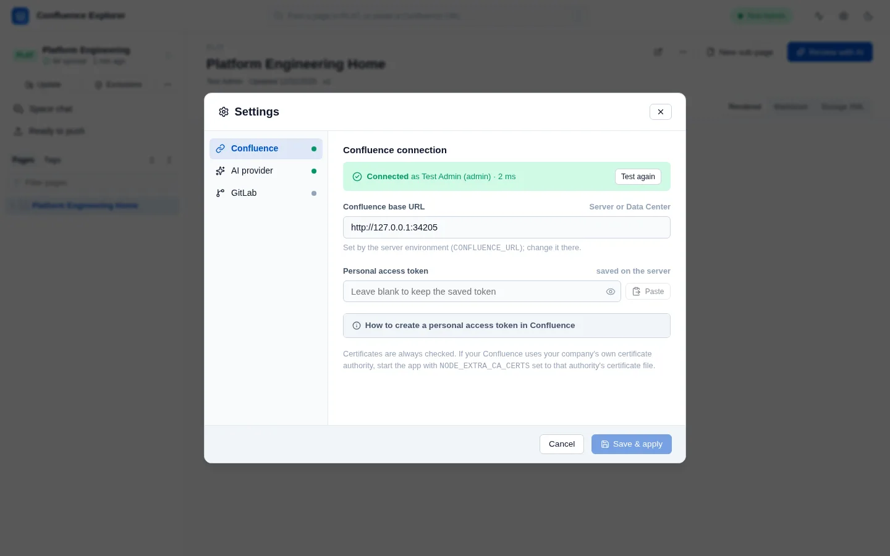

Confluence Explorer talks to one Confluence at a time, using a personal access token that belongs to
your account. The app can only see and change what your account can, so the token decides what the
app is allowed to do.

## Create a personal access token

1. In Confluence, click your profile picture and choose **Settings** or **Profile**, then
   **Personal Access Tokens**.
2. Click **Create token**, give it a name you will recognise later, such as "Confluence Explorer",
   and choose when it expires.
3. Copy the token. Confluence shows it only once.

The Settings dialog repeats these steps under **How to create a personal access token in
Confluence**, in case you need them while connecting.

## Connect in Settings

Open **Settings** from the header, or press Ctrl+, (Cmd+, on a Mac).



- **Confluence base URL** is the address you open Confluence at, such as
  `https://confluence.example.com`. It must start with `https://` or `http://`.
- **Personal access token** is the token you copied. The **Paste** button reads it from your
  clipboard; if your browser blocks that, paste into the field with Ctrl+V.
- **Test connection** tries the address and token you typed, without saving them, and says who you
  are signed in as. Use it before saving, so a typo does not replace a working connection.
- **Save & Apply** saves the connection and reloads the spaces.

To change only the address, type the new one and paste the token again. If you change the address
and leave the token field empty, the saved token is not reused for the new address, so it is never
sent to a server it was not created for.

## Connect with environment variables instead

You can also give the app its connection when you start it. This suits a shared setup, or a machine
where you would rather not type the token into a browser:

```sh
CONFLUENCE_URL=https://confluence.example.com \
CONFLUENCE_PERSONAL_TOKEN=your-token \
npx @simplysf/simply-confluence-explorer@beta
```

When `CONFLUENCE_URL` is set, it is the connection: the Settings dialog shows it but cannot change
it, and says so. The same two variables can also go in a file named `.env` inside the app's data
folder (see below), which the app reads each time it starts. A variable set in the real environment
wins over the same one in that file.

## A company certificate

Confluence Explorer always checks the certificate your Confluence presents, and there is no setting
to turn that off. If your Confluence uses a certificate issued by your company's own certificate
authority, Node.js does not know that authority yet, and connecting fails with a message that the
certificate could not be verified.

Ask your IT team for the certificate authority's file (often ending in `.pem` or `.crt`), and start
the app with `NODE_EXTRA_CA_CERTS` pointing at it:

```sh
NODE_EXTRA_CA_CERTS=/path/to/company-ca.pem npx @simplysf/simply-confluence-explorer@beta
```

The variable must be set when the app starts; the `.env` file in the data folder cannot set it. The
doctor names the file it is using, so you can confirm it took effect.

## Where the connection is kept

Everything the app saves lives in one folder, `~/.confluence-explorer` by default. Start the app with
`--data-dir <path>`, or set `CONFLUENCE_EXPLORER_DATA`, to use another folder.

The connection is saved in `config/connection.json` inside that folder. On macOS and Linux the file
can be read only by your user account; on Windows it is protected by your Windows profile's
permissions, and the doctor says so. The token is never sent back to the browser: the app tells the
page only whether a token is saved.

## Atlassian Cloud

Confluence Explorer works with Confluence Server and Data Center only. Atlassian Cloud signs in
differently and offers a different API, and the app is not built or tested for it. The doctor reports
a Cloud address (one ending in `.atlassian.net`) as unsupported.

## How this is checked

`test/connection.test.ts` and `test/security.test.ts` check that the token is saved owner-only and
never returned, and that a token is not reused for a new address. `test/doctor.test.ts` checks the
certificate hint, the Cloud refusal and the Windows note. `test/e2e/browse.e2e.ts` connects to a real
Confluence Data Center with a personal access token.
