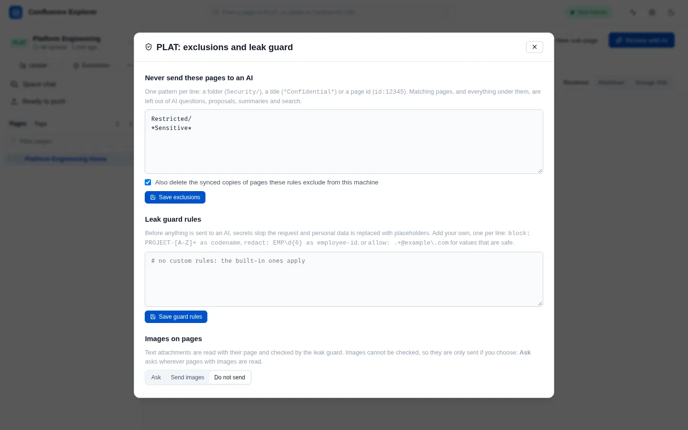

Confluence Explorer runs on your computer and sends page content to exactly one place you did not
already trust: the AI provider you choose. Three things limit what goes there: exclusion rules that
keep whole pages away from the AI, a leak guard that checks everything before it is sent, and a
server that answers only your own computer.

## Excluded pages

Some pages should never be sent to an AI at all, such as anything under a "Restricted" or "HR"
section, however safe a single question about them might look. Each space can have a list of rules,
and a page matched by any rule is excluded, together with **everything under it**.

Open **Space → Exclusions and leak guard…** to edit the list.



Write one rule per line:

| Rule             | Excludes                                                                         |
| ---------------- | -------------------------------------------------------------------------------- |
| `Restricted/`    | The page titled "Restricted" and everything under it                             |
| `*Confidential*` | Every page whose title contains "Confidential", and everything under those pages |
| `id:12345`       | The page with that id, and everything under it                                   |

Lines starting with `#` are ignored. Write page ids as `id:12345`: a bare number also matches any
title that contains it, and the doctor warns about bare numbers.

A rule also matches **anywhere inside a title**, so `Restricted/` excludes "Unrestricted Access
Guide" as well. This errs on the side of excluding too much, which is the safe direction, but it can
surprise you; make a rule more specific if it catches pages it should not.

### What an excluded page is kept out of

An excluded page is treated as if it were not there, everywhere the app could pass it on:

- it is missing from the page tree, and opening it by address says it was not found;
- a sync does not download it, and the ZIP does not contain it;
- it is never sent to an AI: not when you ask about it, not as part of a branch or a whole space, not
  for a summary, and not as a suggestion when you write a new page;
- it does not appear in the app's search.

When you save the rules, the box **Also delete the synced copies of pages these rules exclude from
this machine** is ticked by default, so copies you downloaded before adding a rule are removed too.

If the rules file cannot be read, the app excludes **every** page in that space until it can be, and
the doctor reports the problem. The rules live in `.confluenceignore` in the space's folder, so you
can also edit them in any text editor. Saving from the dialog rewrites that file, and comment lines
you wrote by hand are not kept.

## The leak guard

Everything sent to an AI passes through the leak guard first: your question, the page, earlier turns
of the conversation, and any file you added. The guard looks for two kinds of thing.

**Secrets stop the request.** If the guard finds something that looks like a secret, nothing is sent,
and you are told what was found and on which line, but not the value itself. The guard recognises:

- private keys;
- cloud and service tokens: AWS access keys, GitHub, GitLab, Slack, Atlassian, Google and Stripe
  keys, and AI provider keys;
- JSON web tokens, database connection strings with a password, and Azure storage keys;
- values written after words such as `password`, `secret`, `api_key` or `access_token`, unless the
  value is obviously a placeholder such as `****`, `<your-token>` or `changeme`.

When you ask about many pages at once (a branch or a whole space), a page holding a secret is left
out and named, and the rest are still sent.

**Personal data is replaced.** Email addresses, phone numbers, US Social Security numbers, card
numbers and IBANs are replaced with placeholders such as `[EMAIL-1]` before sending. The AI answers
using the placeholders, and the app puts the real values back into the answer on your screen. Each
value keeps the same placeholder for the whole conversation.

Under each answer, a short line says what the guard did, such as "Leak guard: nothing needed
removing."

### Your own guard rules

The second box in the same dialog holds rules for things only your organisation knows about:

```
block: PROJECT-[A-Z]+ as codename
redact: EMP\d{6} as employee-id
allow: .+@example\.com
```

- `block:` treats a match as a secret, so a request containing it is not sent.
- `redact:` replaces a match with a placeholder, such as `[EMPLOYEE_ID-1]`.
- `allow:` lets a value through that the guard would otherwise stop or replace, when the pattern
  matches the whole value.

Each rule is a regular expression, and matching is case-sensitive. A rule that does not parse is
refused when you save it, with the line number. The rules live in `.confluenceguard` in the space's
folder.

## A record of what was sent

Every request to an AI adds one line to `data/ai-audit.jsonl` in the app's data folder: when it was
sent, to which provider, for which space, how many characters, and how many values the guard
replaced. It never records the content itself.

## Who can reach the app

The app listens on `127.0.0.1`, which only your own computer can reach. It also refuses any request
whose address or origin is not your computer, so a web page open in another tab cannot use it, even
though both run in the same browser.

To use the app from another machine, you must start it with `--host` and list the name you will reach
it by in `ALLOWED_HOSTS`. Think carefully before doing so: the app has no login of its own, so anyone
who can reach it can use your Confluence token through it.

## How this is checked

`test/exclusions.test.ts` checks the rule matching, including everything under an excluded page and
the over-match described above. `test/aiRoutes.test.ts` checks that an excluded page is refused on
every AI route. `test/guard.test.ts` holds sample secrets and personal data for every detector, and
checks that a refusal names the type and line but never the value. `test/security.test.ts` checks
that requests from other hosts and other sites are refused. `test/e2e/ai.e2e.ts` runs the exclusions
and the guard against a real Confluence Data Center.
