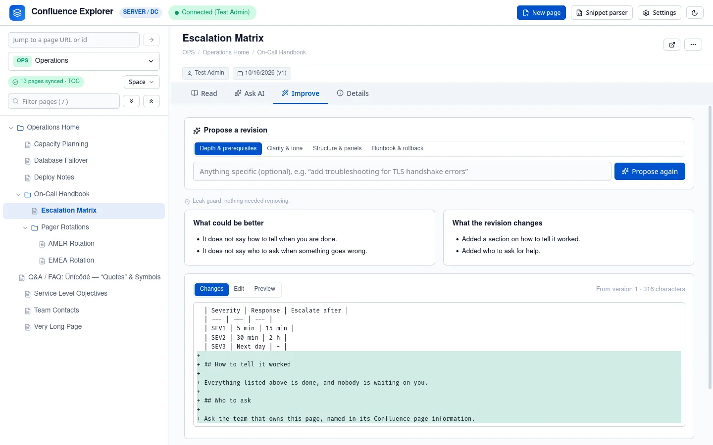
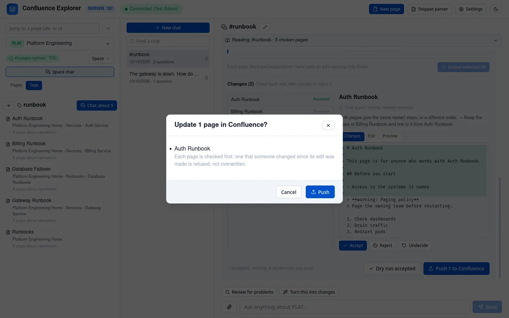
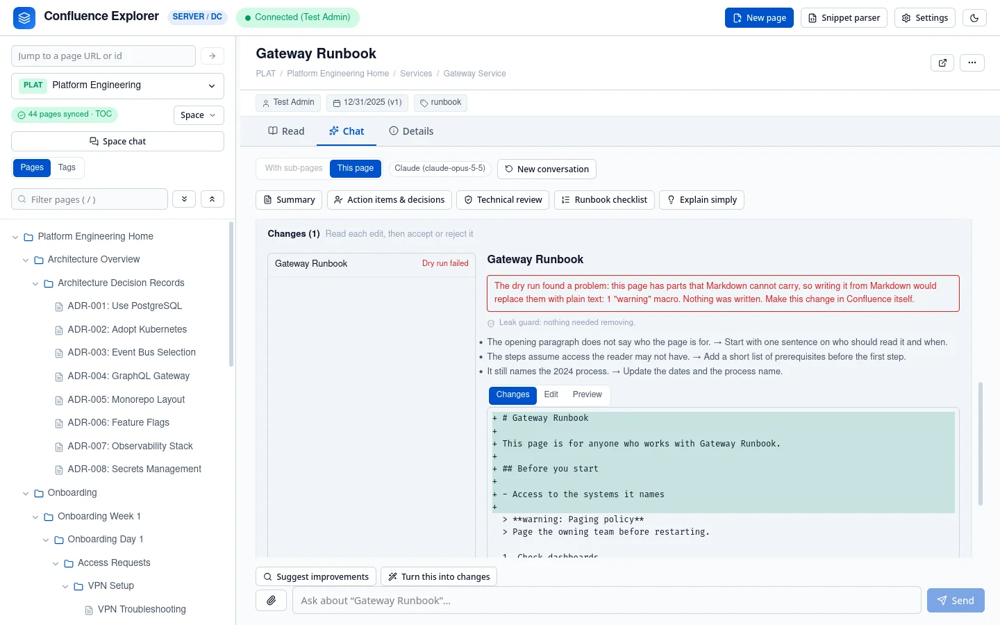

The **Improve** tab asks an AI for a better version of the page you are looking at, shows you exactly
what would change, and writes it to Confluence only when you push it. Nothing changes in Confluence
until you click **Push** in the confirmation that follows **Push to Confluence**.

## Get a proposal

1. Open a page and choose the **Improve** tab.
2. Choose a focus:
   - **Depth & prerequisites**: fill gaps, add what a reader needs to know first.
   - **Clarity & tone**: make it easier to read without changing what it says.
   - **Structure & panels**: reorganise headings and sections.
   - **Runbook & rollback**: for procedures, add checks and a way back.
3. Optionally type something specific, such as "add troubleshooting for certificate errors".
4. Click **Propose**.

The proposal shows:

- **What could be better**: the AI's critique of the page as it is.
- **What the revision changes**: a short list of the changes it made.
- **Changes**: every line added or removed, compared with the page as it is now.
- **Edit**: the proposed text, which you can change before pushing.
- **Preview**: the proposed text, rendered.

The proposal is made from the app's own copy of the page, and it remembers which version of the page
that was. That version matters when you push.

## Check it with a dry run

**Dry run** converts your text exactly as a push would and checks that Confluence would accept it,
without writing anything. It tells you about anything that cannot be written, with the line it is on.

## Push it

**Push to Confluence** asks you to confirm, naming the page, the version it goes from and to, and the
Confluence it goes to.

After the push, the page reloads with its new version. If the space is synced, your copy is updated
from what Confluence now holds. If the text you pushed is identical to what Confluence already had,
Confluence makes no new version; for a page in a synced space, the app tells you so.

### If someone else changed the page

A push names the version its proposal was made from. If anyone has changed the page in Confluence
since then, the push is refused, and nothing is written. Their edit is never replaced by a proposal
made before it. Click **Propose again** to start from the page as it is now.

## Pages that cannot be pushed

Some parts of a Confluence page have no form in Markdown: images, macros such as status labels,
panels, Jira issues, expand sections and tables of contents, links to other pages, mentions, task
lists and page layouts. The app shows each as text in brackets, such as `[image: chart.png]` or
`[status: LIVE]` (see [Keeping a copy on disk](/guides/local-copy/)).

A push replaces the whole page, so pushing that text would replace each of those parts with its
bracketed placeholder. To prevent that, **the dry run and the push refuse any page that holds one of
them**, name exactly what it would lose, and write nothing.

Code blocks are the exception: they survive the round trip and do not stop a push. A page made of
headings, paragraphs, lists, tables and code can be improved and pushed; for any other page, use the
proposal as a guide and make the change in Confluence itself.

This rule follows the converter, not a fixed list. If a later version learns to carry a part, such as
status labels, pages holding it can be pushed without any change on your side.

## Things a push never does

- It never starts from a page excluded from AI: such a page cannot get a proposal, so the Improve tab
  has nothing to push for it.
- It never writes the frontmatter block at the top of the Markdown; that is removed first.
- It never merges your text with someone else's edit; it refuses instead.

## How this is checked

`test/pagePush.test.ts` checks that a proposal names its version, that a dry run writes nothing, that
a push made from an old version is refused, that the frontmatter never reaches Confluence, and that a
page with an image or a page link is refused. `test/converter.test.ts` checks what a page would lose.
`test/e2e/push.e2e.ts` pushes to a real Confluence Data Center, including the refusal when a colleague
edited the page and the refusal for a page with a panel.
