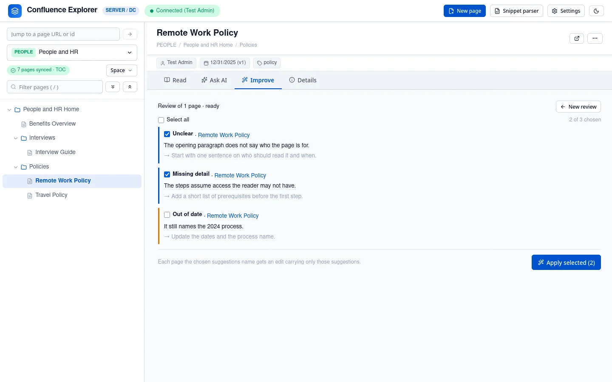

The **Improve** tab reviews the page you are looking at, lets you choose which of the AI's suggestions
to apply, shows you exactly what would change, and writes it to Confluence only when you push it.
A section of pages, or every page with a tag, is reviewed the same way (see
[Reviewing a section](/guides/reviewing-a-section/)).

## Review the page

1. Open a page and choose the **Improve** tab.
2. Under **What to look for**, untick anything you do not want: accuracy and contradictions,
   repetition, out of date, clarity and tone, depth and prerequisites, structure, and runbook and
   rollback. All are ticked to start.
3. Optionally add anything to focus on, or context the AI should know, such as "we moved from Jenkins
   to GitLab CI in 2025".
4. Click **Review 1 page**. A moving bar shows it is working, and **Stop** ends it at once.

Each suggestion says what is wrong and what to do. A review changes nothing.

## Apply the suggestions you want

Tick the suggestions you agree with, or **Select all**, and click **Apply selected**. The AI writes an
edit of the page that carries out only those suggestions and leaves the rest of the page as it is.
The edit shows:

- the suggestions it applies, and any it could not;
- **Changes**: every line added or removed, compared with the page as it is now;
- **Edit**: the edited text, which you can change before accepting it;
- **Preview**: the edited text, rendered.

Click **Accept**, or **Accept with my edits** after changing the text, or **Reject**. The edit is made
from the app's own copy of the page, and it remembers which version of the page that was. That
version matters when you push. **Back to the suggestions** returns to the list, so you can apply a
different set.

## Check it with a dry run

**Dry run accepted** converts the accepted text exactly as a push would and checks that Confluence
would accept it, without writing anything. It tells you about anything that cannot be written.

## Push it

**Push 1 to Confluence** asks you to confirm, naming the page, then writes it.

After the push, the page reloads with its new version. If the space is synced, your copy is updated
from what Confluence now holds.

### If someone else changed the page

A push names the version its edit was made from. If anyone has changed the page in Confluence since
then, the push is refused, and nothing is written. Their edit is never replaced by an edit made
before it. Click **New review** to start from the page as it is now.

## Pages that cannot be pushed

Some parts of a Confluence page have no form in Markdown: images, macros such as status labels,
panels, Jira issues, expand sections and tables of contents, links to other pages, mentions, task
lists and page layouts. The app shows each as text in brackets, such as `[image: chart.png]` or
`[status: LIVE]` (see [Keeping a copy on disk](/guides/syncing-a-space/)).

A push replaces the whole page, so pushing that text would replace each of those parts with its
bracketed placeholder. To prevent that, **the dry run and the push refuse any page that holds one of
them**, name exactly what it would lose, and write nothing.

Code blocks are the exception: they survive the round trip and do not stop a push. A page made of
headings, paragraphs, lists, tables and code can be improved and pushed; for any other page, use the
edit as a guide and make the change in Confluence itself.

This rule follows the converter, not a fixed list. If a later version learns to carry a part, such as
status labels, pages holding it can be pushed without any change on your side.

## Things a push never does

- It never starts from a page excluded from AI: such a page cannot be reviewed, so the Improve tab
  has nothing to push for it.
- It never writes the frontmatter block at the top of the Markdown; that is removed first.
- It never merges your text with someone else's edit; it refuses instead.

## How this is checked

`test/branchRuns.test.ts` checks that an edit carries only the chosen suggestions and names its version.
`test/pagePush.test.ts` checks that a dry run writes nothing, that
a push made from an old version is refused, that the frontmatter never reaches Confluence, and that a
page with an image or a page link is refused. `test/converter.test.ts` checks what a page would lose.
`test/e2e/push.e2e.ts` pushes to a real Confluence Data Center, including the refusal when a colleague
edited the page and the refusal for a page with a panel.
