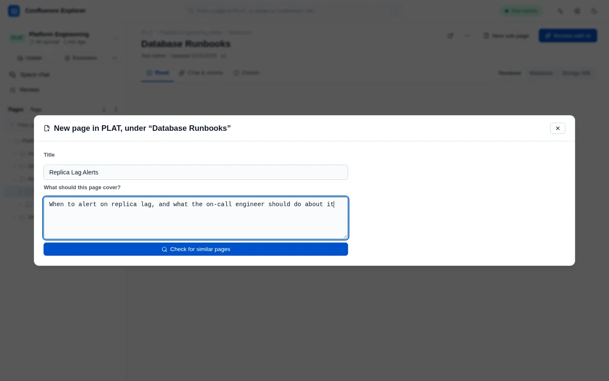
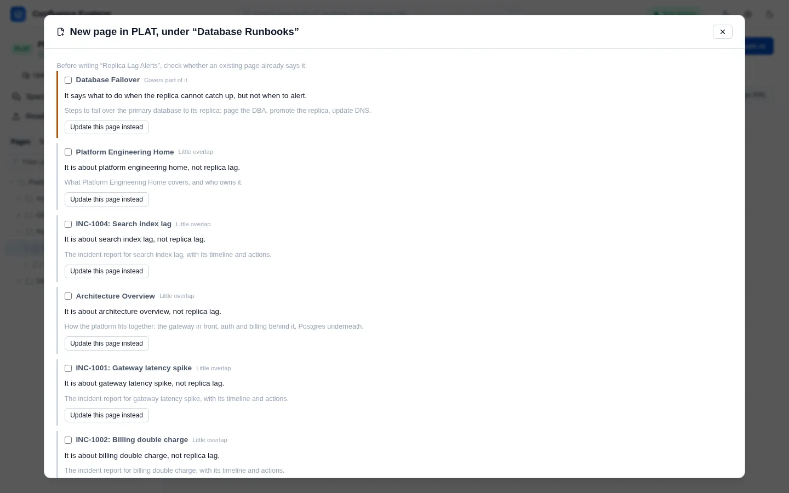
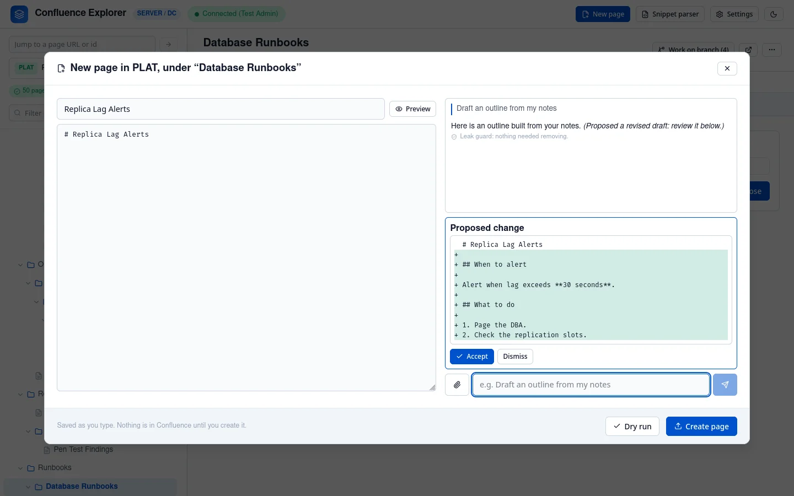
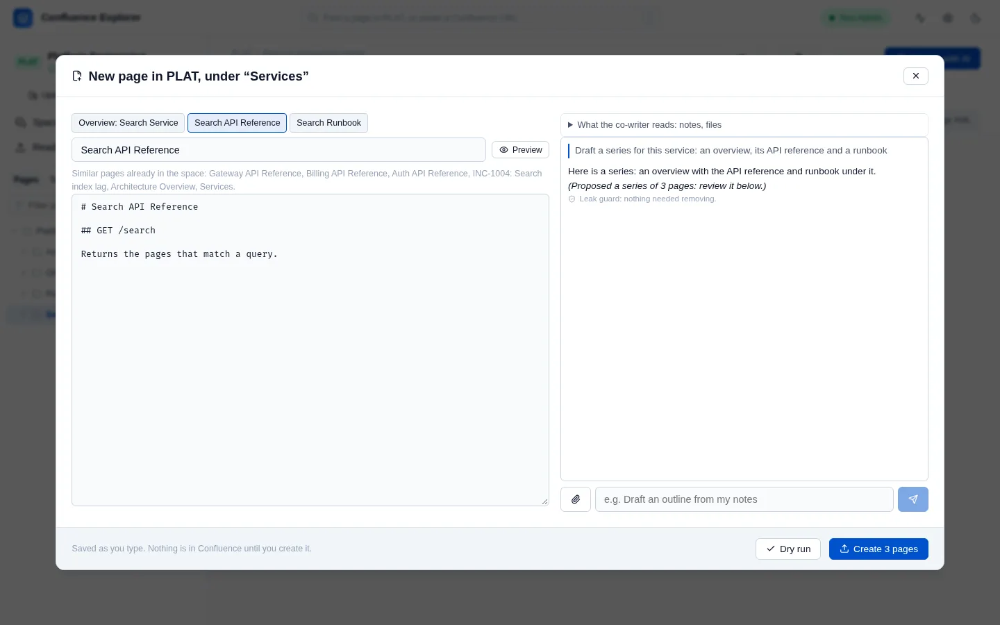

The most common way documentation goes wrong is a second page that says what an existing page already
says, slightly differently. So before you write a new page, Confluence Explorer looks for pages that
already cover the topic, and asks you what to do about them.

## Describe the page

Open the page the new one should go under, and click **New sub-page** at the top of the page.

Give it a **Title**, describe **What should this page cover?**, and click **Check for similar
pages**.

## Check for pages that already cover it

The app searches the space, both your synced copy and Confluence's own search, and if an AI is set
up, asks it how much each page found overlaps with what you described.

Each page found is marked **Already covers this**, **Covers part of it** or **Little overlap**. Then
choose one:

- **Update this page instead** opens that page, so you can improve it rather than write a new one.
- **Link to N selected and continue** goes ahead with the new page, and gives the pages you ticked to
  the AI as context, so the new page can refer to them instead of repeating them.
- **Continue anyway** goes ahead without them.

Excluded pages are never offered. Without an AI, the pages are ranked by matching words, and the app
says so.

## Write it

Write in the editor on the left; it saves as you type, and nothing is in Confluence yet. On the right,
ask the AI for help, such as "Draft an outline from my notes", and add files with the paperclip if
they help. While it answers you can **Stop** it, and your question comes back to edit. When the AI proposes new text for the whole page, it appears as a set of changes with
**Accept** and **Dismiss**; it is never applied without you.

**What the co-writer reads**, above the conversation, gives it more to work from:

- **Follow the structure of an existing page**, such as another service's page, or **paste a
  structure** of headings to follow. Click **Use these**.
- **Read a GitLab repository**: paste the link to a repository on your company's GitLab and click
  **Add**. The app reads its file list, README, docs, API description files and manifest, and adds
  them to the conversation as a file. Set GitLab up first under **Settings → GitLab** (see
  [Connecting to Confluence](/guides/connecting/)).

### A series of pages

When the material needs more than one page, such as a service's overview, its API and its runbook,
the co-writer can propose a series. **Accept the series** turns the draft into those pages, shown as
tabs: the overview first, then the pages that go under it. Edit each one, and check the similar pages
the app found for each title.

Unfinished drafts are kept on your computer. **New sub-page** offers to continue a draft you started in the
same space.

## Create it

**Dry run** checks that Confluence would accept the page, or every page of a series, without
creating anything. **Create** asks you to confirm, then creates the page under its parent, once; a
series is created overview first, then each page under it, in order. If Confluence refuses one, the
app names the pages already created, and the rest stay in the draft to fix and create again. Afterwards you can open it in the app or
in Confluence. If the space is synced, the new page is added to your copy straight away.

Confluence refuses a title that is already used in the space; the app tells you so, and you can change
the title and try again.

## How this is checked

`test/drafts.test.ts` checks that the existing page is found, that excluded pages are never offered,
that nothing is written or created before the check is answered, that an AI proposal is kept apart
until accepted, that a page is created only once, that a title already in use is refused, that an
excluded page cannot be followed, that a repository passes the leak guard, and that a series is created
in order. `test/gitlab.test.ts` checks that only the configured GitLab is read.
`test/e2e/drafts.e2e.ts` creates a page in a real Confluence Data Center.
