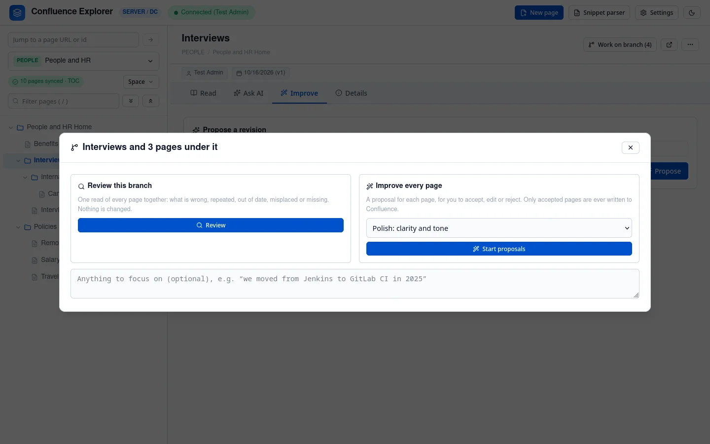
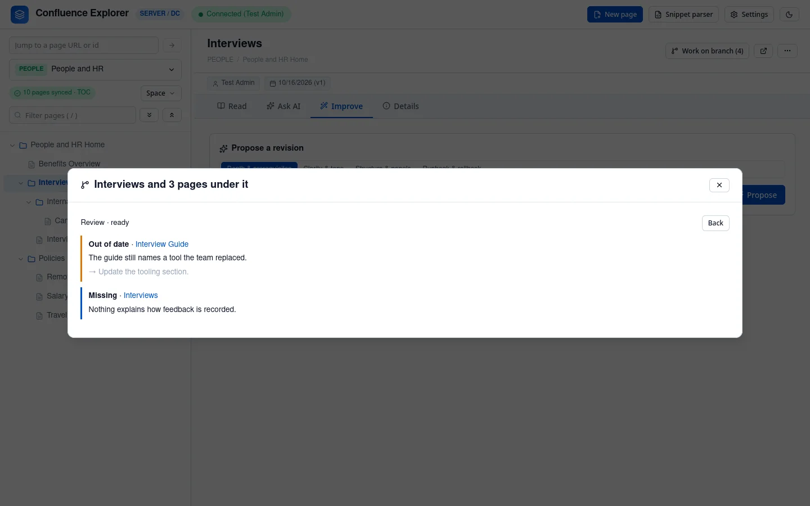
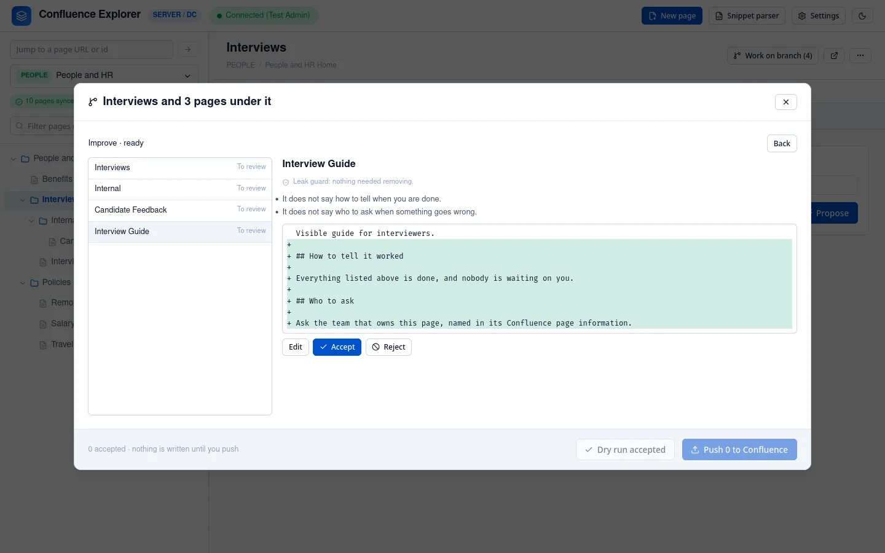

A section is a page and every page under it. **Review section** lets you look at all of it at once: either one review that reads every page together, or a proposal for each page that you
accept or reject one by one. Nothing is written to Confluence until you push the pages you accepted.

The button appears on a page that has pages under it in the synced copy, so sync the space first. It
shows how many pages the section holds.

## Review the section

**Review** sends every page in the section to the AI together, and asks what is wrong across them:

- **Incorrect or contradictory**: pages that disagree with each other or are wrong;
- **Redundant**: pages that say the same thing;
- **Out of date**: content that no longer holds;
- **Structure**: pages in the wrong place;
- **Missing**: something the section should explain and does not.

While the AI reads, a moving bar shows how long it has been working, and **Stop** ends the request
at once. You can close the dialog and keep browsing: the header shows the review until it is ready,
and clicking it brings you back. Each finding names the pages it is about; click a name to open that
page. A review changes nothing.

## Improve every page

**Start proposals** asks for a proposed revision of each page in turn, with the focus you choose
(**Polish: clarity and tone** by default) and anything specific you type in the box below. The
proposals arrive one at a time, and you can start deciding before they are all ready.

For each page, read the critique and the changes, then:

- **Accept** it as it is;
- **Edit** it, then **Accept with my edits**;
- **Reject** it;
- **Undecide**, to put it back to be reviewed.

When you have decided:

- **Dry run accepted** checks every accepted page without writing anything.
- **Push N to Confluence** asks you to confirm, then writes the accepted pages one at a time. Each one
  is checked against the version its own proposal was made from, so a page someone else changed in
  the meantime is refused while the others are still written. The queue shows the result for each
  page.

The same rules apply as for a single page (see [Improving a page](/guides/improving-pages/)): a page
whose images, macros or links Markdown cannot carry is refused, by the dry run and by the push, with
the reason shown next to it.

## What is left out

- **Excluded pages** are left out of both the review and the proposals, without being named.
- **Pages holding a secret** are left out and listed under "Left out", so you know they were not
  read.
- **A review that is too large** to send in one request leaves out the pages that do not fit, and
  lists them too.

Runs are saved on your computer, so a queue survives restarting the app. Earlier runs on the same
section are listed when you open it again.

## How this is checked

`test/branchRuns.test.ts` checks that excluded pages are left out, that only accepted pages are
written, that a page changed by someone else is refused while the others are written, that a dry run
writes nothing, that decisions made while proposals arrive are kept, and that a stopped review keeps
nothing. `test/e2e/branches.e2e.ts`
runs a section against a real Confluence Data Center.
