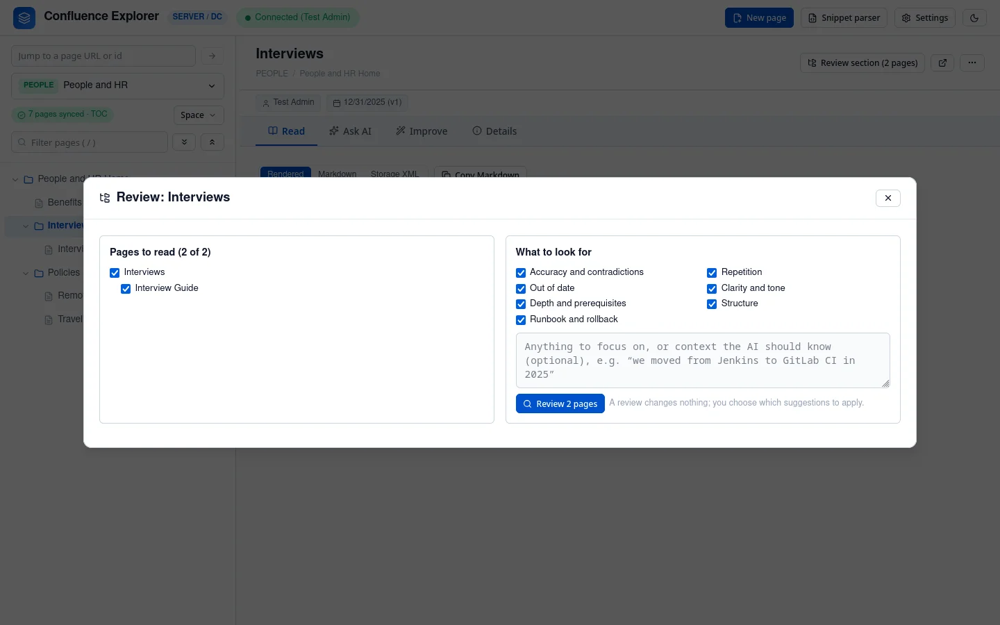
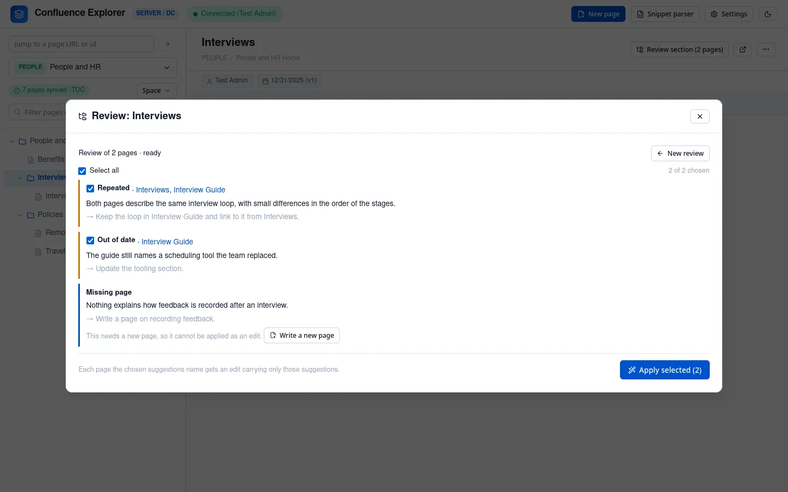
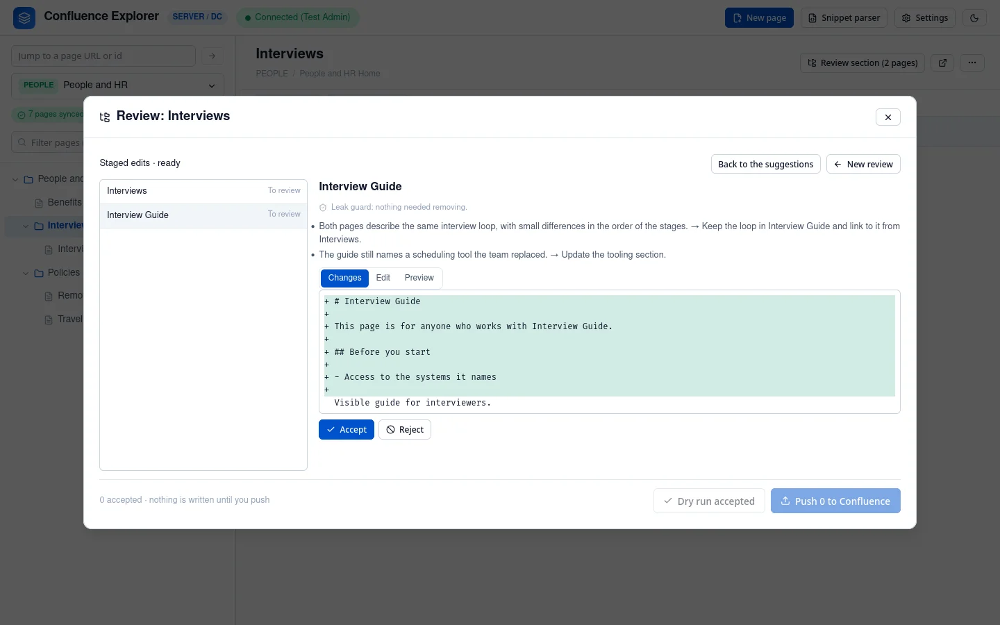

A section is a page and every page under it. **Review section** reads them together and lists what is
wrong across them: pages that contradict or repeat each other, content that is out of date, and
pages that are missing or in the wrong place. You choose which suggestions to apply, read each page's
edit, and push only the ones you accept. Nothing is written to Confluence until you push.

The button appears on a page that has pages under it in the synced copy, so sync the space first. It
shows how many pages the section holds. A single page is reviewed the same way on its **Improve** tab
(see [Improving a page](/guides/improving-pages/)).

## Choose the pages and what to look for

Every page in the section is listed and ticked; untick any you want to leave out. Pages excluded from
AI are never listed. Under **What to look for**, untick anything you do not want, add anything the AI
should focus on or know, and click **Review**.

The pages are sent to the AI together. While it reads, a moving bar shows how long it has been
working, and **Stop** ends the request at once. You can close the dialog and keep browsing: the
header shows the review until it is ready, and clicking it brings you back.

## Choose the suggestions to apply

Each suggestion names the pages it is about; click a name to open that page. Tick the ones you agree
with and click **Apply selected**. Each page a ticked suggestion names gets an edit that carries out
only the suggestions about it. When a suggestion is about repetition across two pages, each page's
edit is told which other page shares the content.

Two kinds of suggestion cannot be carried out by editing a page, so they cannot be ticked: a page
that should be moved, split or merged, which you do in Confluence, and a page that should exist and
does not. For a missing page, **Write a new page** opens [Writing a new page](/guides/new-pages/)
with the suggestion filled in.

## Decide on each edit

The edits arrive one page at a time, and you can start deciding before they are all ready. For each
page, read the suggestions it applies and its changes, then:

- **Accept** it as it is;
- **Edit** it, then **Accept with my edits**;
- **Reject** it;
- **Undecide**, to put it back to be reviewed.

When you have decided:

- **Dry run accepted** checks every accepted page without writing anything.
- **Push N to Confluence** asks you to confirm, then writes the accepted pages one at a time. Each one
  is checked against the version its own edit was made from, so a page someone else changed in the
  meantime is refused while the others are still written.

The same rules apply as for a single page: a page whose images, macros or links Markdown cannot carry
is refused, by the dry run and by the push, with the reason shown next to it.

## Review the pages that carry a tag

Pages about one subject often sit in different parts of a space: a DevOps section near the top, and
a DevOps page inside a project. **Tags** at the top of the sidebar lists every tag in the synced
space with how many pages carry it. A page's tags are its Confluence labels together with the topic
tags of its AI summary (**Space → Generate AI summaries**).

Choose a tag to see its pages, each with where it sits in the space and its summary; click one to
open it. **Review** opens the same review as a section, with the tagged pages listed and ticked:
untick any you want to leave out, and the suggestions, edits and push work exactly as above. The
header shows a running tag review as **Review: #tag**.

## What is left out

- **Excluded pages** are never listed, read or edited, and never named.
- **Pages holding a secret** are left out and listed under "Left out", so you know they were not
  read.
- **A review that is too large** to send in one request leaves out the pages that do not fit, and
  lists them too. A review reads at most 50 pages.

Reviews and their edits are saved on your computer, so they survive restarting the app. Earlier runs
on the same section are listed when you open it again.

## How this is checked

`test/branchRuns.test.ts` checks that only the ticked pages are read and excluded ones never are,
that a page outside the section or without the tag is refused, that an edit carries only the chosen suggestions, that
only accepted pages are written, that a page changed by someone else is refused while the others are
written, that a dry run writes nothing, and that a stopped review keeps nothing.
`test/e2e/branches.e2e.ts` reviews a section and pushes its edits against a real Confluence Data
Center. `test/localCopy.test.ts` checks that a tag never lists an excluded page.
