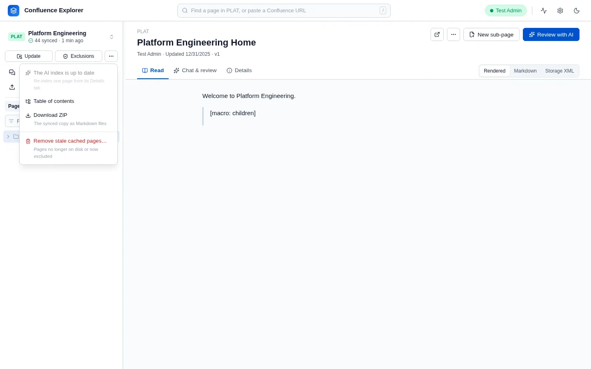
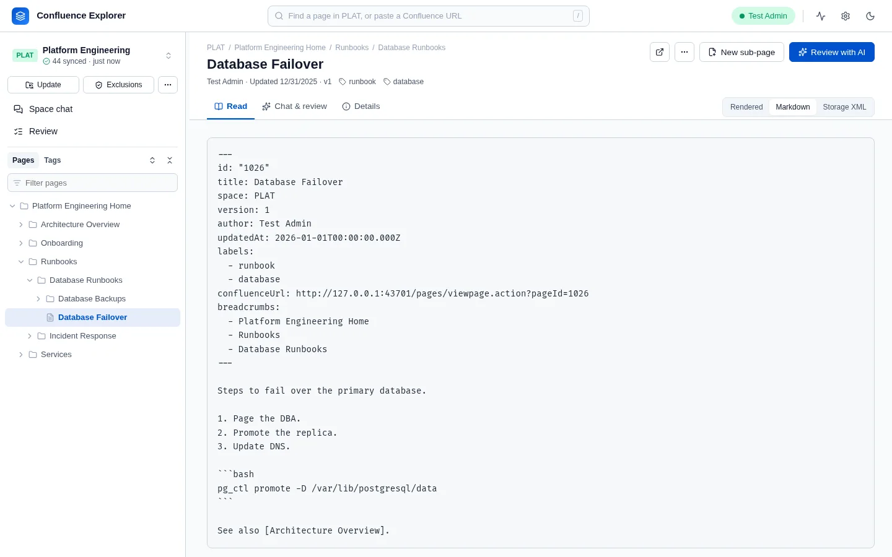
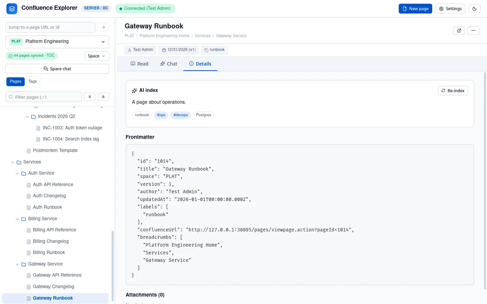

Syncing a space downloads every page you are allowed to see, as Markdown files in folders that follow
the page tree, together with each page's attachments. Once a space is synced, the app reads it from
your disk instead of from Confluence, and the AI features that work across many pages use that copy.

## Sync a space

Choose a space in the sidebar and click **Sync**, under the space's name.



The sidebar shows progress as the pages arrive, with a **Stop** button, and the header shows it too
while you browse; if you reload the page, the progress comes back. When the sync finishes, a
message says how many pages were downloaded and how many were already current or excluded, and the
line under the space's name changes from **Not synced** to the number of pages synced and when.

Run it again at any time with **Update**, which takes the place of **Sync**. Only pages that changed in Confluence since the last
sync are downloaded again, with any page whose attachments were added or replaced there, or are missing here. A page about to be edited is always read from Confluence first, and its
copy here is updated if it is older (see [Changing pages](/guides/changing-pages/)).

Some things to know about a sync:

- **It covers the whole space**: every page under the space's home page, or every page in the space
  if it has no home page.
- **Excluded pages are never downloaded**, nor is anything under them. See
  [What leaves your computer](/guides/data-safety/).
- **It adds and updates; it never deletes.** A page that was deleted, renamed or moved in Confluence
  keeps its old file on your disk until you remove it, as described below.
- **Stopping a sync keeps what was already written**, but the table of contents is not rebuilt until
  a sync finishes.

## Browse the copy

A synced space behaves the same as a live one, but faster and without asking Confluence for each
page. The tree on the left is read from your disk, and the page view shows the copy. To see a
page's latest version, sync the space again.

- **Find a page**: type part of its title into the search at the top of the window, or press `/` to
  jump to it, and pick the page from the list. Paste a Confluence page address or a page id there
  instead, and the app finds the page and switches to its space.
- **Filter pages**: type in the box above the tree. A page stays visible if it, or any page under it,
  matches.
- **Read it three ways**: the **Read** tab shows the page **Rendered**, as **Markdown**, or as
  **Storage XML**, Confluence's own format, chosen at the right of the tabs. **Copy Markdown**, in the
  **⋯** menu at the top of the page, copies the text.



### What the Markdown looks like

Each page's Markdown starts with a short block of details between `---` lines, called frontmatter:
the page id, title, space, version, author, last update, labels, address and the titles of the pages
above it. The rest is the page itself.

Markdown has no form for some parts of a Confluence page, so the app shows them as text in brackets
rather than dropping them:

| In Confluence                       | In the Markdown                               |
| ----------------------------------- | --------------------------------------------- |
| A status label                      | `[status: ACCEPTED]`                          |
| An info, note, warning or tip panel | `> **warning: Paging policy**` and its text   |
| Any other macro                     | `> [macro: jira]`, `> [macro: toc]` and so on |
| An image                            | `[image: capacity-chart.png]`                 |
| A link to another page              | The page's title, in brackets                 |
| A mention of a person               | `[@...]`, with the person's user name or key  |
| A code block                        | A fenced code block, with its language        |
| A task list                         | `- [x]` and `- [ ]`                           |

A change to a page keeps these parts as markers instead and writes each one back exactly; see
[Changing pages from a chat](/guides/changing-pages/).

## The table of contents

**Table of contents**, in the **⋯** menu beside **Exclusions**, shows every synced page as a tree, with its AI summary and
topics once those exist. Click a title to open the page. The same table is saved as `TOC.md` and
`toc.json` in the space's folder, so other tools can use it.

**Build the AI index** in the same menu asks your AI about each synced page, one at a time: what it
is for, its topics, the questions it answers, and a line on each section. With a provider
that offers embeddings, it embeds each section too (see [Asking an AI](/guides/asking-ai/)). It keeps
going while you open other pages: the header shows how far it has got, and clicking it takes you
back. Starting it again while it runs shows the same run rather than starting a second one. You can
pause it and come back later. It only does pages that are not indexed yet; once every page is, the
menu says so; to redo one page, use **Re-index** on its **Details** tab. A page's index entry and
embeddings are removed when a sync downloads a newer version of it, so they are never out of date,
and **Update the AI index** redoes just those pages.



## Download a ZIP

**Download ZIP** gives you the whole synced space as one file: the Markdown of every page, their
attachments, and the table of contents. Pages excluded by the space's rules are left out, even if a
copy of them is still on your disk.

## Remove pages from your computer

Removing a page here deletes only your copy. Nothing changes in Confluence.

- **One page**: open it, choose **⋯ → Remove from this machine…**, and decide whether to remove the
  pages under it as well. By default the app also adds a rule to the space's exclusions, so the next
  sync does not download the page again.
- **Stale copies**: **Remove stale cached pages…** in the **⋯** menu removes copies that the space's
  rules now exclude, and copies whose Markdown file you deleted yourself. **Delete the copy of KEY…** removes the whole space, keeping its rules and chats; sync it again to bring it back.

## Where the files are

Each synced space has its own folder inside the app's data folder (`~/.confluence-explorer` unless
you chose another with `--data-dir`), beside `telemetry/`, the app's own logs and traces:

```
spaces/PLAT/
  pages/                 one Markdown file per page, in folders that follow the tree
  pages/.../Title_attachments/   each page's attachments, kept in step with Confluence at each sync
  pages_cache/           each page as Confluence sent it
  metadata/              the AI index: summaries, topics, questions
  vectors/               section embeddings, when a provider makes them
  TOC.md, toc.json       the table of contents
  catalog.json           each page's title, place, labels and AI tags, without its text
  manifest.json          when the space was last synced
  .confluenceignore      the space's exclusion rules
  .confluenceguard       the space's leak guard rules
```

A page's tags are its Confluence labels with the topics the AI index gives it. The app keeps them in
`catalog.json`, and updates it whenever it syncs a page, indexes one, or removes one, so tags and the
page tree open at once without reading every page. A space synced before the catalog existed builds
it the first time its tags are opened, showing its progress; this happens once.

You can open the Markdown files in any editor. If you delete one, **Remove stale cached pages…**
tidies up what the app still remembers about it.

## How this is checked

`test/localCopy.test.ts` checks that a sync writes every visible page and no excluded one, downloads
only what changed the second time, serves the tree and pages from disk, and builds the table of
contents and the ZIP. `test/converter.test.ts` holds the expected Markdown for every page in the test
dataset. `test/e2e/localCopy.e2e.ts` syncs a real Confluence Data Center space.
