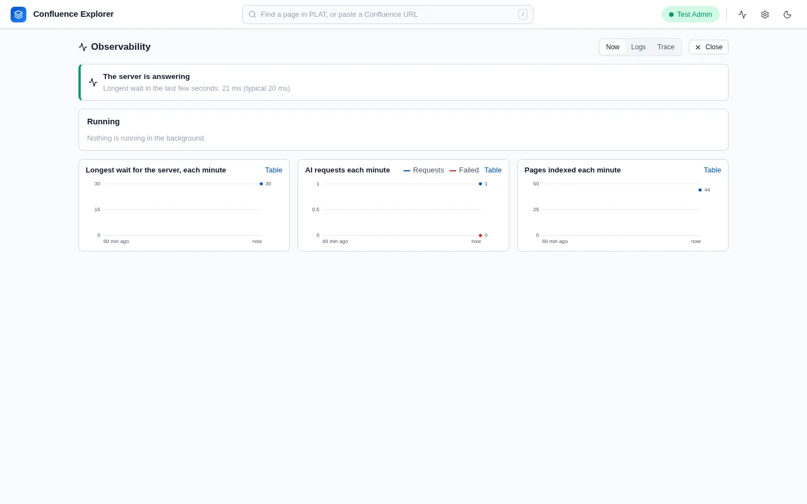

Start with the doctor. It checks everything the app depends on and prints a fix for each problem:

```sh
npx @simplysf/simply-confluence-explorer doctor
```

Each line starts with `✓` (fine), `!` (a warning), `✗` (a failure) or `-` (does not apply), followed
by a `fix:` line for anything that is not fine. The doctor exits with an error only when a check
fails, so you can use it in a script. Add `--json` for the report as JSON. While the app is running,
the same report is at `http://127.0.0.1:4280/api/doctor`.

## The doctor's checks

| Check               | What it looks at                                      | If it complains                                                                                   |
| ------------------- | ----------------------------------------------------- | ------------------------------------------------------------------------------------------------- |
| `node-version`      | Node.js is version 22 or later                        | Install a current Node.js.                                                                        |
| `confluence-config` | A Confluence address and token are saved              | Connect in Settings, or set `CONFLUENCE_URL` and `CONFLUENCE_PERSONAL_TOKEN`.                     |
| `server-type`       | The address is not Atlassian Cloud                    | Connect to a Confluence Server or Data Center instead.                                            |
| `confluence-auth`   | Confluence accepts the token                          | Check the address opens from this computer and the token has not expired; see certificates below. |
| `tls-verification`  | The connection is encrypted                           | Use the `https://` address of your Confluence.                                                    |
| `data-dir`          | The app can write to its data folder                  | Make the folder writable, or choose another with `--data-dir`.                                    |
| `ignore-files`      | Each space's exclusion rules can be read              | Fix the file's permissions. Until then, every page in that space is excluded.                     |
| `ignore-rules`      | Page ids in exclusion rules are written as `id:12345` | Change bare numbers to `id:` rules.                                                               |
| `guard-rules`       | Each space's leak guard rules parse                   | Fix the rule named. Until then, AI requests for that space are refused.                           |
| `ai-engine`         | An AI provider is set up                              | Choose a provider in Settings, or install the Gemini CLI.                                         |
| `telemetry`         | Problems the app flagged in the last day              | Open the Observability page to see each one with its trace.                                       |

## The Observability page

**Observability** in the header shows what the app is doing and what went wrong, without leaving it.
A number on the button counts problems you have not seen yet.

- **Now**: running jobs with their progress, requests in flight and how long each has run, the search
  index being built, and how long the server took to respond lately, with charts for the last day.
- **Logs**: recent events, searchable and filtered by level, kind and space. Repeated messages are
  grouped with a count, so 300 copies of one indexing error read as one line.
- **Trace**: one action, such as a question or an index run, as a timeline of its steps. A question's
  trace shows the search, the sections chosen, what was sent and how long the AI took.

**Trace** on an answer, **See why** on a failed index run or review, and **See logs** on an error
message open it at the right place. The app flags a problem by itself when its own work blocks the
server for over two seconds (once per freeze; a delay the computer causes, such as sleep, is only a
number on **Now**), when a request fails its check of what was sent, when most AI requests fail, and
when an index run leaves pages out.



It is kept in `telemetry/` in the data folder for 14 days, up to 200 MB: counts, durations, ids, page
titles and error messages, never page text, questions, answers, keys, or the title of an excluded page.

## Common problems

### The app does not start

- **"Invalid port"**: the port given with `--port` or `PORT` is not a number from 0 to 65535. Use `0`
  to let the app pick a free one.
- **The port is already in use**: another program, or another copy of the app, is using 4280. Stop
  it, or start with `--port 4281`.

### It cannot connect to Confluence

- **"Confluence refused the token"**: the token is wrong or has expired. Create a new one and save it
  in Settings.
- **"The certificate could not be verified"**: your Confluence uses a company certificate. Start the
  app with `NODE_EXTRA_CA_CERTS` pointing at your company's certificate authority file; see
  [Connecting to Confluence](/guides/connecting/).
- **"Confluence is not configured"**: no address or token is saved, or the address is an Atlassian
  Cloud one, which is not supported.
- **The address in Settings is greyed out**: the connection comes from `CONFLUENCE_URL` in the
  environment. Change it there and restart the app.

### A page or space is missing

- **"No pages found"**: your account cannot see any pages in that space, or the space is empty. Check
  in Confluence that you can open it.
- **"Page not found, or excluded by .confluenceignore"**: the page is excluded by the space's rules,
  or it no longer exists. Check **Exclusions**, under the space's name; remember that a rule matches
  anywhere inside a title.
- **A page you deleted in Confluence is still in the tree**: a sync never deletes. Remove the copy
  with **⋯ → Remove from this machine…**.
- **"With sub-pages" is missing**: it needs the space to be synced.

### The AI does not answer

- **"The server did not answer in 30 s"**: it is busy, usually building the search index of a large
  space for the first time. **Observability → Now** shows what it is doing.

- **"No AI provider is set up"**, **"no API key is set"** or **"no model is chosen"**: finish the
  setup under **Settings → AI provider**. ChatGPT needs a model chosen.
- **"The Gemini CLI was not found"**: install it, or enter its location in Settings, or choose an API
  provider.
- **"Not sent to the AI: this looks like it contains a secret"**: the leak guard found something on
  the line it names. Remove it from the page, exclude the page, or, if it is not really a secret, add
  an `allow:` rule; see [What leaves your computer](/guides/data-safety/).
- **"This page is excluded from AI"**: the space's rules exclude the page. Ask about the whole space
  in Space chat instead, or change the rules.
- **A file is refused**: files can be up to 10 MB, a PDF must contain text rather than scanned images,
  and only text-like formats are accepted.

### A push or dry run is refused

- **"This change would remove parts of the page that no accepted change removes"**: the text has lost
  a marker such as ⟦1 toc⟧, or put one inside code. Reset to the AI's edit, or put the marker back on
  a line of its own; see [Changing pages from a chat](/guides/changing-pages/).
- **"… is not a part of this page"** or **"… appears twice"**: a marker was invented or repeated.
  Remove it, or reset to the AI's edit.
- **"This page changed in Confluence after the proposal was made"**: someone edited the page since.
  Click **Make this edit again from the current page**.
- **"Line N: … is not supported in Markdown input"**: the text has something the converter cannot
  write, such as an image written as `![...]`, raw HTML, a footnote or a task list. Edit that line.
- **"A page titled … already exists"**: page titles must be unique within a space. Choose another.

## Still stuck

Run the doctor with `--json` and include its output, with any tokens removed, when you
[open an issue](https://github.com/SimplySF/simply-confluence-explorer/issues).

## How this is checked

`test/doctor.test.ts` checks every doctor check, and that every warning and failure carries a fix.
`test/telemetry.test.ts` checks what is kept, that nothing on the never-recorded list is, and the
problems flagged; `test/scale/responsiveness.scale.ts`, run with `pnpm run test:scale`, checks the
server answers while a 3,200-page index builds.
`test/cli.test.ts` checks the port handling and that the doctor exits with an error when a check
fails.
